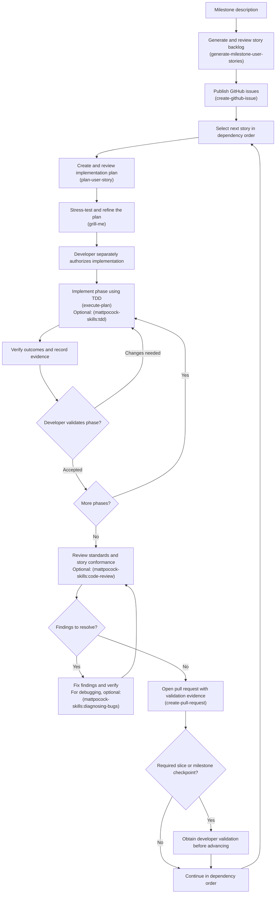

# IDE Smoke Test Harness Proof-of-Concept

A planned smoke-test harness for Visual Studio Code or IntelliJ IDEA and selected extensions/plugins after IDE or extension updates. GitHub Copilot Chat is the initial extension target. Prove feasibility on macOS first, then add Windows support after developer approval.

**Status:** Milestone 0 and M1-00 (Slice 0) were completed and developer validated on 2026-10-20. M1-01 is complete and developer validated: Phase 1 and Phase 2 were accepted on 2026-10-20. Phase 2 adds strict YAML configuration, guarded runs, structured events, saved summaries, and non-GUI acceptance tests. M1-04 now implements production T01 launch/readiness with observed owned shutdown and conservative GUI workspace retention; Phase 2 was developer validated on 2026-10-21. T02–T05 remain unimplemented. See the [T01 evidence](docs/reports/M1-04-phase2.md). See the [M1-01 evidence](docs/reports/M1-01-phase2.md). M1-02 profile safety is complete and developer validated on 2026-10-21. See the [M1-02 evidence](docs/reports/M1-02-phase2.md). M1-03 workspace safety is complete and developer validated on 2026-10-21; combined Slice 1 was developer validated on 2026-10-21.

## Completed work

- **Milestone 0 — Environment setup:** Verified the existing macOS tooling and created an isolated, repository-local uv environment using Python 3.12.15 arm64. See the [setup implementation plan](specifications/ide-milestone0-implementation-plan.md) and [final checks](docs/implementation-plans/M0-05.md#execution-results--2026-10-20).
- **M1-00 — Copilot Chat feasibility:** Automation submitted `Reply with exactly the word READY.` through the VS Code Copilot Chat UI. Review of saved host evidence verified `response.strip() == "READY"` for the associated assistant response. See the [revised plan](docs/implementation-plans/M1-00.md) and [execution report](docs/reports/M1-00-phase1.md#reduced-scope-result--saved-evidence-review).

The feasibility result used macOS 15.7.9, VS Code 1.135.0, bundled GitHub.copilot-chat 0.63.0, Python 3.12.15 arm64, and binary-installed PyObjC 12.2.2 packages. The tested path required Accessibility access, a visible graphical session, manual sign-in, and `editor.accessibilitySupport=on` in the dedicated test profile. Exact spike dependencies and commands are in the [spike README](scripts/spikes/m1_00/README.md) and [requirements](scripts/spikes/m1_00/requirements.txt).

Completion detection, cancellation/error discrimination, restart authentication reuse, and broader repeatability remain unqualified. The owned test instance was closed, temporary settings were restored, and the authenticated profile was preserved. The broader behavior below remains future design.

## Start here

- [Milestone 0 environment setup](specifications/ide-milestone0-environment-setup.md) — macOS setup with uv, a Python virtual environment, and supporting software tooling.
- [Harness proposal](specifications/ide-copilot-smoke-harness-proposal.md) — architecture, test scope, isolation strategy, reporting, risks, and delivery milestones.
- [Milestone 1 user stories](specifications/ide-copilot-milestone1-user-stories.md) — VS Code proof-of-concept backlog, acceptance criteria, implementation slices, and developer validation gates.
- [VS Code testing overview](docs/vscode-testing-overview.md) — background notes on VS Code's testing layers, extension host/API tests, and integration test runner.

## Planned behavior

The harness will launch a dedicated IDE test instance, create a disposable workspace, and verify observable outcomes:

| Test | Expected outcome |
| --- | --- |
| T01: Launch IDE | The intended test instance becomes usable within a timeout. |
| T02: Open project and file | The disposable workspace and expected file are open. |
| T03: Edit and save | An edit made through the IDE is independently verified on disk. |
| T04: Open Copilot Chat | Chat is available, with authentication problems classified separately. |
| T05: Submit a prompt | A fresh assistant response completes and satisfies a defined assertion. |

Runs are intended to record the host OS and version, installed IDE and extension versions, timings, results, and sanitized diagnostics. Proposed outcomes distinguish passing tests, functional failures, blocked prerequisites, and harness errors.

Milestones define delivery outcomes. Implementation phases within each milestone will be defined during implementation.

## Planned architecture

Separate adapter contracts cover IDE lifecycle (`IDE`), editor file operations (`EditorFiles`), and extension behavior, initially `Copilot`. File and extension adapters receive the IDE instance at construction time and target that session. Additional selected extensions introduce their own contracts, adapters, and tests without adding extension-specific methods to the IDE contract.

Contracts, logical tests, orchestration, and verification remain platform-neutral. UI automation, process handling, and scheduling have platform-specific implementations, selected for the configured IDE and local host OS. Windows dependencies and implementation are deferred until Milestone 2.

## Delivery milestones

| Milestone | Outcome |
| --- | --- |
| 0 | Prepare the macOS environment — complete and developer accepted on 2026-10-20. |
| 1 | Prove VS Code and Copilot Chat on macOS with T01–T05 — M1-00 complete; foundation and main harness pending. |
| 2 | Set up the Windows environment, validate feasibility, and support the same VS Code/Copilot tests on Windows. |
| 3 | Add IntelliJ IDEA support on macOS and Windows. |
| 4 | Strengthen reliability and diagnostics on both platforms. |
| 5 | Add release monitoring and platform-specific scheduling. |

Each milestone requires developer validation before proceeding. Windows support must establish its own UI automation, response-completion detection, isolation, and authentication-reuse evidence; macOS success does not establish Windows compatibility.

## Development workflow

Use these skills to move from a milestone description to reviewed implementation. Skill invocations are agent prompts, not shell commands.



1. **Generate the backlog — [generate-milestone-user-stories](.agents/skills/generate-milestone-user-stories/SKILL.md).** Invoke, for example, `$generate-milestone-user-stories milestone=2`. The skill uses the proposal for scope and the Milestone 1 backlog as its structural model, asks about consequential decisions, and writes or refines `specifications/ide-copilot-milestone<N>-user-stories.md`. Review the stories, acceptance criteria, dependencies, evidence requirements, and developer gates.
2. **Publish the stories — [create-github-issue](.agents/skills/create-github-issue/SKILL.md).** Input: the reviewed `specifications/ide-copilot-milestone<N>-user-stories.md` file produced in step 1. For example: “Use `$create-github-issue` to create one GitHub issue per story in `specifications/ide-copilot-milestone2-user-stories.md`.” The skill uses the repository issue template and preserves story IDs, acceptance criteria, dependencies, evidence requirements, and developer gates.
3. **Plan the next eligible story — [plan-user-story](.agents/skills/plan-user-story/SKILL.md).** Supply its issue or specification reference. The skill saves a technical plan under `docs/implementation-plans/`, with phases, tasks, verification, and developer checkpoints. Review the plan before execution.
4. **Stress-test the plan — `grill-me`.** Before execution, use the skill to challenge assumptions, surface missing decisions, and refine the saved plan. If the installed plugin exposes this skill as `mattpocock-skills:grilling`, use that name. Resolve the questions and review the revised plan before authorizing implementation.
5. **Authorize and implement the plan — [execute-plan](.agents/skills/execute-plan/SKILL.md).** Separately instruct the agent to execute the approved Markdown plan, for example `$execute-plan docs/implementation-plans/M1-02.md`. The skill checks off tasks only after completion and verification, records evidence in the plan, and stops at the end of every phase for developer validation, including the final phase. Use `mattpocock-skills:diagnosing-bugs` for debugging or `mattpocock-skills:tdd` when test-first development is requested and those plugin skills are available.
6. **Review the changes — `mattpocock-skills:code-review`.** When available, use this plugin skill to review repository standards and conformance to the originating story. Resolve findings and present validation evidence for developer review; code review does not replace the required developer validation.
7. **Open a pull request — [create-pull-request](.agents/skills/create-pull-request/SKILL.md).** Request a PR using the repository template, describing the resulting behavior and validation evidence.

Repeat planning, implementation, review, and PR creation in dependency order. Stop at each required developer checkpoint before advancing to the next phase, slice, or milestone. Future milestone backlogs may be drafted early, with prerequisite approvals recorded explicitly.

Generating a backlog, creating issues, and approving a plan do not authorize implementation. Implementation requires a separate developer instruction. Plugin skills named above are optional tooling and must be available in the agent session; the linked repository-local skills live in this checkout.

## Milestone 1 scope

Milestone 1 targets **Visual Studio Code and GitHub Copilot Chat on macOS**. The package supports Python 3.12 only; 3.12.15 arm64 is the qualified interpreter. Production T01 uses PyObjC 12.2.2 through isolated macOS workers. The lock includes its five-distribution graph, PyYAML, pytest, and the pure-Python Flit Core backend; configuration handling is implemented for the small schema in [the example](config/harness.example.yaml).

The project follows YAGNI: install tools and dependencies only for demonstrated needs in the current milestone. Setup and execution use prebuilt software and pure-Python packages or compatible prebuilt wheels, with dependency source builds disabled. Local native compilation and compiler toolchain installation are out of scope; any dependency requiring them must be reconsidered.

**M1-00: Validate Copilot Chat automation feasibility** is complete for the reduced request/response scope. **M1-01: Bootstrap the Python project and CLI** is complete and developer validated on 2026-10-20. It provides the foundation; M1-04 adds production T01 and is complete and developer validated on 2026-10-21. M1-02 profile safety is complete and developer validated on 2026-10-21. M1-03 disposable workspace safety is complete and developer validated on 2026-10-21; combined Slice 1 was developer validated on 2026-10-21. See the [execution report](docs/reports/M1-03-phase1.md).

Implementation proceeds in reviewable slices: feasibility, foundation, IDE file operations, Copilot Chat, and repeatability/reporting. Each slice requires developer validation. Milestone 1 acceptance includes five consecutive unattended passing runs on unchanged IDE and Copilot versions.

Windows environment setup and support, IntelliJ IDEA support, release monitoring, and scheduling are later milestones. Inline completion, agent workflows, and code-edit verification are outside the initial Milestone 1 scope.

## Planned operating environment

- A usable, logged-in graphical session on each host and the platform-specific automation permissions established by its feasibility spike; initially macOS, with Windows validated in Milestone 2.
- A dedicated persistent IDE test profile on each host, with selected extensions installed and authenticated manually where required; initially Copilot.
- Fresh disposable workspaces for each run, separate from personal projects and the persistent profile.
- Sequential GUI execution to avoid keyboard-focus conflicts.
- Valid authentication and network/service availability for Copilot Chat tests.

The design preserves authenticated test profiles between runs and classifies expired authentication as blocked. It does not automate passwords or MFA, transfer authenticated profiles or credentials between hosts, or modify personal projects or everyday IDE profiles.

## Setup and usage

The existing spike can verify retained local evidence without launching VS Code or sending another request:

```bash
.venv/bin/python scripts/spikes/m1_00/verify_saved_ready.py
```

This command requires the ignored observation/tree artifacts from the original host run; they are not included in a fresh checkout. See the [spike README](scripts/spikes/m1_00/README.md#current-result-and-offline-reproduction) for prerequisites and reproduction details. These scripts are experimental feasibility tools, not a general harness.

The foundation package and development tests can be installed from this checkout using the existing Homebrew Python and uv. For a fresh checkout, first create the local environment (no Python download):

```bash
/opt/homebrew/bin/uv venv --python /opt/homebrew/bin/python3.12 --no-python-downloads --offline .venv
```

Preserve an existing `.venv`. Install locked dependency/backend wheels, then install only the local pure-Python package offline:

```bash
/opt/homebrew/bin/uv sync --locked --inexact --no-install-project --no-build --no-python-downloads --python /opt/homebrew/bin/python3.12 --cache-dir reports/m1-01/uv-cache
/opt/homebrew/bin/uv pip install --python .venv/bin/python --no-python-downloads --no-deps --no-build-isolation --offline --cache-dir reports/m1-01/uv-cache --editable .
.venv/bin/ide-smoke --help
.venv/bin/python -m pytest
```

Keep both installation steps: the first prohibits third-party source builds and preserves spike packages; the second uses the wheel-installed backend without resolving dependencies or isolated build requirements. Avoid plain `uv sync`, which can prune the spike packages and does not enforce this recipe. Exact versions and clean-environment evidence are in the [Phase 1 report](docs/reports/M1-01-phase1.md); `uv.lock` is the version source of truth. No compiler setup is required.

Use `.venv/bin/ide-smoke` explicitly, or activate `.venv` to put the bare command on PATH. Copy [config/harness.example.yaml](config/harness.example.yaml) to `config/harness.local.yaml`, then edit the executable and existing dedicated-profile paths. The larger configuration in the proposal is illustrative and is not accepted by this CLI. Configuration loading is read-only. Admitted runs create a fresh disposable workspace after availability and profile safety pass. Follow the
[profile safety setup guide](docs/vscode-test-profile-setup.md) for the required
real `user-data`/`extensions` directories and dedication marker. Guarded runs now
validate profile safety after basic availability: unsafe profiles block with exit 3,
and uncertain inspection yields exit 4. A `profile_safe` event establishes no GUI
readiness. M1-02 Phase 2 is complete and developer validated on 2026-10-21. See the [Phase 2 evidence](docs/reports/M1-02-phase2.md). Run:

```bash
ide-smoke run --ide vscode
```

**With admitted resources and a reserved usable desktop, this runs T01.** T01 PASS records installed IDE version and startup duration; T02–T05 remain unimplemented SKIP, so overall exit 4 is expected. Admission failures still skip all five. See [T01 setup and limits](docs/vscode-test-profile-setup.md#production-t01-launch-requirements). Help exits successfully.

The default config path is relative to the caller's current working directory. An explicit `--config PATH` is also relative to that directory; `~` is expanded. Paths inside YAML are relative to the configuration file, with `~` expansion; a bare executable name is searched on PATH. Selecting a config elsewhere does not relocate reports. Run evidence is saved as `reports/<run-id>/summary.json`, `workspace.json`, and `events.jsonl` under the caller's working directory.

Workspace paths are fixed beneath the actual editable-source checkout's ignored
`workspaces/` root, independently of cwd and config location. Each admitted run
exclusively creates a generated child with `example.py` containing
`message = "original fixture"` and a trailing newline. Existing roots require
`.ide-smoke-workspaces.json` with exactly
`{"schema_version":1,"purpose":"ide-smoke-workspaces"}`; unmarked roots block
without adoption or repair. Profiles remain separate and persistent.

Optional `harness.workspace.retain_on_failure` accepts only a boolean and defaults
to `false`. Every workspace whose GUI session entered launch is retained, even
on PASS with observed cleanup PASS and configured `false`, using reason
`gui_exit_scope_limited`. This reflects deferred unseen-child exit qualification.
The manifest preserves the configured value. Non-GUI operations keep the M1-03
policy: remove on pass/nonpass by default; `true` retains known nonpassing runs. Operation/process cleanup failure or inability to save
initial ownership metadata also preserves the workspace. Uncertain ownership
is preserved for inspection. Required removal refusal/failure is a cleanup error.
A final report or guard-release failure discovered after deletion cannot restore
the workspace; evidence records its actual disposition.

Each report includes a `workspace` manifest in `summary.json` and an atomic
`workspace.json` sidecar. It records schema/run identity, generated paths, fixed
target name, initial fixture SHA-256, requested retention, disposition, and a
controlled reason; it excludes contents and cleanup authority. Dispositions are
`not_created`, `created`, `removed`, `retained`, and `cleanup_failed`. The initial
manifest precedes deletion. If an update fails, a sidecar can remain at an earlier
disposition; a successfully saved summary reports that evidence error.

Retained or abandoned workspaces are never automatically reused or swept. To
recover one, identify the exact run and generated direct child from its report,
confirm no run/process is using it, inspect its contents and current real path,
and deliberately remove only that identified child using your file manager.
Preserve the root marker, other children, and profiles. An on-disk marker alone
does not authorize cleanup. Hard kills can leave resources and incomplete reports.
See the [M1-03 report](docs/reports/M1-03-phase1.md) for the qualified deletion
mechanism, safety tests, installed-console status, and limitations.

Every admitted run contends nonblocking on `~/.ide-smoke/desktop-run.lock` before configuration is loaded. The OS-held lock serializes cooperating invocations for one macOS user across checkouts and configurations, remains held through cleanup and reporting, and is never unlinked during release. A contender writes its own blocked report and cannot act on the owner's resources. Help does not acquire the lock. OS lock release after termination does not establish cleanup of future IDE processes.

The supported schema requires `macos`, `sequential`, positive finite numeric timeouts, an executable path/name, and an explicit dedicated-profile directory. Unknown or duplicate keys, malformed/empty YAML, missing fields, wrong types, and invalid timeouts are usage errors. Positive absence of an executable/profile is `BLOCKED`; indeterminate access is `HARNESS ERROR`. Availability checks do not launch anything or inspect profile contents. Existing nonexecutable files are not described as missing; profile safety belongs to the revised M1-02 scope. Executable runnability, permissions, session, settings, and Copilot/authentication readiness qualification are outside M1-02.

Results use `PASS`, `FAIL`, `BLOCKED`, `HARNESS ERROR`, and dependent `SKIP`. An observed assertion mismatch is `FAIL`; an unexplained timeout is `HARNESS ERROR`, with its cause left unknown. Dependent operations stop after the first nonpass result, retain its cause, and attempt registered cleanup. Cleanup errors preserve individual results and make the run nonzero.

| Exit code | Meaning |
| --- | --- |
| `0` | All five assertions passed with successful cleanup; also ordinary help. Public runs cannot pass the complete suite yet. |
| `1` | Functional `FAIL` without a harness error. |
| `2` | Argument/configuration usage error; parsed runs save configuration errors where possible. |
| `3` | Identified prerequisite `BLOCKED`, including an active competing run. |
| `4` | Runtime `HARNESS ERROR`, unimplemented execution, cleanup failure, or evidence-writing failure. |
| `130` | Handled Ctrl-C; cleanup/evidence failures override this with `4`. |

Runtime severity is `HARNESS ERROR` before `FAIL` before `BLOCKED`; skipped or incomplete suites cannot erase their origin or yield success. A handled in-operation interruption preserves completed tests and records the interrupted test as HARNESS ERROR with elapsed duration; dependent tests SKIP with that origin. Cleanup and evidence finalization still run. Hard kills and machine failures cannot guarantee evidence or future IDE cleanup.

Terminal output is brief: outcome, controlled explanation, and the saved summary path. Report failures explicitly state that no summary was saved, with nonzero status; partial event/temporary files may remain. Structured diagnostics contain run/test metadata, controlled reason codes/messages, and relevant configuration keys/resource paths. They omit configuration contents, credentials, environment dumps, prompts/responses, and arbitrary exception text/tracebacks. Unknown-key diagnostics identify the supported parent section without echoing arbitrary key names.

The [Phase 2 report](docs/reports/M1-01-phase2.md) records test coverage and local evidence paths. Production T01 evidence is in the [M1-04 report](docs/reports/M1-04-phase2.md); editor/Copilot operations and richer reporting remain later work.

Future runs will execute on the local host using platform-specific executable and profile paths. The proposal's illustrative configuration targets macOS; Windows setup and configuration will be established in Milestone 2.

[M1-01 is developer validated](docs/implementation-plans/M1-01.md#phase-2-execution--2026-10-20).
M1-02 is limited to **dedicated test-profile safety**: safe paths/layout, explicit
dedication, and read-only preservation. Phase 1 was developer validated on
2026-10-21; the separately authorized Phase 2 was also completed and developer
validated on 2026-10-21. The [plan](docs/implementation-plans/M1-02.md)
and [Phase 2 report](docs/reports/M1-02-phase2.md) map the acceptance criteria to
294 passing non-GUI tests, synthetic blocked/error cases, and real installed-console
evidence. The developer confirmed dedication and explicitly authorized exclusive
marker creation. Real-profile validation records `profile_safe` before expected
unimplemented exit 4; narrow metadata and guard release/reacquisition checks pass.
The [setup guide](docs/vscode-test-profile-setup.md) describes the implemented policy.
Historical qualification and decisions remain in the
[Phase 1 report](docs/reports/M1-02-phase1.md).

Profile safety establishes no executable, session, permission, settings, Copilot,
or authentication readiness. Future GUI runs still require an unlocked,
exclusively reserved desktop. M1-03 is complete and developer validated on 2026-10-21; combined Slice 1
was developer validated on 2026-10-21. M1-04 Phase 2 is complete and developer validated on 2026-10-21. M1-05 and later work require separate authorization.

## Repository contents

```text
.
├── AGENTS.md                       # Repository instructions and validated environment notes
├── LICENSE
├── pyproject.toml / uv.lock       # Foundation metadata and locked dependencies
├── .python-version               # Shared Python 3.12 series pin
├── src/ide_smoke/                 # CLI, configuration, results, reporting, and lock
├── tests/                        # Non-GUI unit and process qualification
├── README.md
├── .agents/skills/                 # Repository workflow skills
├── docs/
│   ├── implementation-plans/       # Milestone 0 and Milestone 1 plans/results
│   ├── reports/M1-00-phase1.md     # Historical probes and accepted reduced-scope result
│   └── vscode-testing-overview.md
├── scripts/spikes/m1_00/
│   ├── README.md                  # Current result, reproduction, historical probe usage
│   ├── requirements.txt           # Exact tested spike dependency pins
│   ├── preflight.py               # Prerequisite checks
│   ├── discover.py                # Owned IDE lifecycle and UI discovery
│   ├── diagnose_proxy.py          # Historical editor-readback diagnosis
│   ├── observe_response.py        # Fixed-prompt submission and bounded observations
│   └── verify_saved_ready.py      # Offline verification of retained READY evidence
└── specifications/
    ├── ide-milestone0-environment-setup.md
    ├── ide-milestone0-implementation-plan.md
    ├── ide-copilot-smoke-harness-proposal.md
    └── ide-copilot-milestone1-user-stories.md
```

The local `.venv/`, test profiles, disposable workspaces, and raw evidence under `reports/` are ignored and are not distributed with the repository. `.python-version` is now a shared project file. Reports outside this checkout do not inherit its ignore rules.
