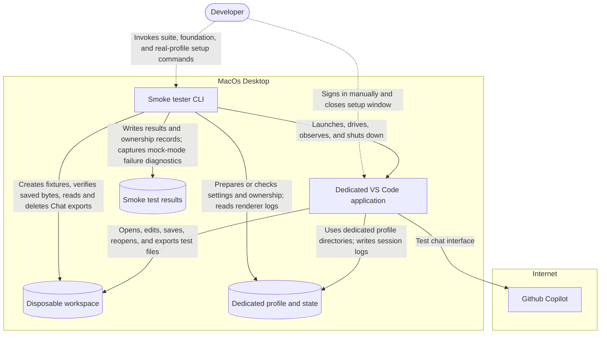

# VS Code Smoke Tester

This branch contains the standalone TypeScript VS Code smoke tester under [`smoke/`](smoke/README.md). `basic` runs editing → Chat; Git is a standalone suite selected with `--suite git`. After the PR #39 P2 cleanup removed unused Git/Chat integration support, compilation and all 74 non-GUI tests pass. The [Git plan](docs/implementation-plans/issue-38-git-smoke-test.md) records developer-validated phases 1 and 2, passing production Git-only GUI runs, and the later decision to remove Git from combined runs. After Ask-selection failures, Chat startup was restored from the previously passing `b9a4cc4` implementation; the restored mocked editing/Chat `basic` GUI run passed both suites. Before the rename, restored real combined passed. After the rename, mocked `basic` passed; real `basic` initially failed on a Copilot error/warning, then passed a developer-requested rerun without code changes. Standalone Git passed its latest GUI run. Phase 3 is complete and developer accepted for the revised scope. Earlier editing-only, two-turn mocked Chat-only and editing/Chat combined GUI commands were verified against VS Code 1.135.0 / Copilot Chat 0.63.0 on macOS arm64. The developer accepted the foundation, selected suites and final handoff. The [completed plan and execution record](docs/vscode-smoke-tester-plan.md) preserve verification and compatibility limits.

The optional [real Copilot backend](docs/implementation-plans/real-chat-backend.md) supports `--chat-backend real` for Chat and combined runs, with a dedicated persistent profile and manual sign-in setup. Slices 1 and 2 are developer validated; the PR #39 P2 cleanup is also developer accepted after passing standalone Git, mocked `basic` and real `basic` GUI runs. Authorized real Chat-only and combined editing/real Chat runs passed on 2026-10-23. The developer validated the issue #36 sign-in fix on 2026-10-23; signed-out blocking is GUI verified, and authenticated Chat passed after manual sign-in restoration. See [setup and real-mode usage](smoke/README.md#optional-real-copilot-backend).




[Solution Design document](./architectures/smoke-solution-design.md)


## Start here

- [Current setup, commands, artifacts and compatibility](smoke/README.md) — the delivered standalone tester.
- [Preserved Python environment](docs/preserved-python-environment.md) — preservation rules and procedures for separately authorized Python environment work.
- [Harness proposal](specifications/ide-copilot-smoke-harness-proposal.md) — historical architecture and milestone design, pending review for the replacement.
- [Milestone 1 user stories](specifications/ide-copilot-milestone1-user-stories.md) — historical acceptance criteria and delivery slices.
- [Milestone 0 environment setup](specifications/ide-milestone0-environment-setup.md) and [implementation plan](specifications/ide-milestone0-implementation-plan.md) — retained environment planning.
- [Implementation plans](docs/implementation-plans/) — historical plans, decisions, and recorded progress.
- [VS Code smoke testing research](docs/research/vscode-tester-approach.md) and [macOS accessibility research](docs/research/macos-ax-accessibility.md) — background for choosing the next approach; claims require verification before implementation.
- [VS Code testing overview](docs/vscode-testing-overview.md) — testing layers and extension-host/API testing context.

Historical documents retain their original decisions and completion records. Those records describe the previous implementation, not runnable functionality in this branch. References to removed files are labelled as historical paths. Replacement design and implementation require separate developer direction; old approvals do not authorize resumption.

## Setup and usage

```sh
npm --prefix smoke ci
npm --prefix smoke run compile
npm --prefix smoke run test:unit
npm --prefix smoke run smoke -- --build "/Applications/Visual Studio Code.app" --suite basic
```

GUI execution needs authorization and an unlocked reserved desktop. Select `editing`, `git`, `chat`, or `basic` (default, editing → Chat). Git runs only through `--suite git`, starts no mock Chat server and preserves its dedicated `profiles/smoke-git`. Renamed mocked `basic` passed GUI verification; real `basic` passed a developer-requested rerun after an earlier Copilot error/warning failure. See [usage and recovery](smoke/README.md) for results, isolation and version requirements.

The retained Python environment is preserved separately from the TypeScript tester. Its metadata and installed entry points may reference removed source. Before proposing or performing authorized Python environment changes, follow the [preservation guide](docs/preserved-python-environment.md) for interpreter constraints, dependency procedures, and historical limitations.

## Development workflow

See the [development workflow](docs/development-workflow.md) for the workflow diagram, skill invocations, and developer validation checkpoints.

Repository-local skills remain available for [backlog generation](.agents/skills/generate-milestone-user-stories/SKILL.md), [story planning](.agents/skills/plan-user-story/SKILL.md), [plan execution](.agents/skills/execute-plan/SKILL.md), [issue creation](.agents/skills/create-github-issue/SKILL.md), and [pull request creation](.agents/skills/create-pull-request/SKILL.md).

The replacement plan is complete and developer accepted. Follow [repository instructions](AGENTS.md) and use TDD for future software changes. New scope requires developer direction. GUI execution requires authorization and an unlocked reserved desktop; these were authorized for the recorded qualifications. Retained historical stories are reference material until explicitly selected or revised.

## Repository contents

- `specifications/` — retained planning and specification artifacts.
- `smoke/` — standalone TypeScript tester, helper extension, and non-GUI tests.
- `docs/implementation-plans/` — historical implementation plans and decisions.
- `docs/research/` and `docs/vscode-testing-overview.md` — retained research and background.
- `docs/preserved-python-environment.md` — current preservation and authorized-work procedures for the retained Python environment.
- `.agents/skills/` and `.github/` — workflow skills and issue/PR templates.
- Root uv metadata and `LICENSE` — preserved project environment definitions and licensing.

Ignored local `.vscode/`, `.venv/`, and `profiles/` remain unchanged. Previously preserved workspace data remains in `reports/m1-03/preserved-workspaces/`. Other raw reports, report-local uv caches/environments, disposable workspaces, local harness configuration, and experiment state were removed. Ignored files are shared across branch switches in this checkout; they are not distributed with the branch. Profiles and saved workspace data remain private local resources, not automatic inputs to a replacement harness.

## Historical Notes

The [`homegrown-smoke-tester` branch](https://github.com/jimthompson5802/ide-tester/tree/homegrown-smoke-tester) archives the earlier Python/PyObjC harness that preceded the TypeScript tester now on `main`.

The archived implementation includes:

- A Python CLI, YAML configuration, orchestration, reporting, profile safety, and disposable workspace management.
- A production T01 launch/readiness check using macOS UI automation and owned-process cleanup.
- Incomplete editor automation for opening, editing, and saving files.
- Copilot Chat feasibility scripts demonstrating a fixed prompt/response exchange.
- Tests, implementation plans, qualification reports, and accessibility research.

At the archive checkpoint, records reported **544 passing non-GUI tests** and successful T01 host checks. Production **T02–T05 remained unavailable**, and editor automation was on hold. These results have not been rerun; historical approvals do not authorize resuming the work.

The earlier implementation, tests, experiments, and execution reports were removed from `main`. Specifications, historical plans, research, development workflows, and the existing uv/Python environment remain. The archived branch points to commit `71dbe31`, dated 2026-10-22; deleted ignored artifacts are not recoverable from Git.
