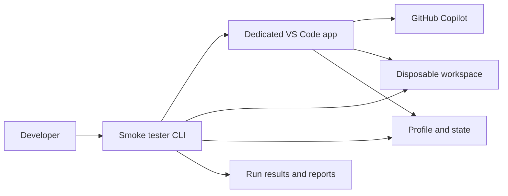
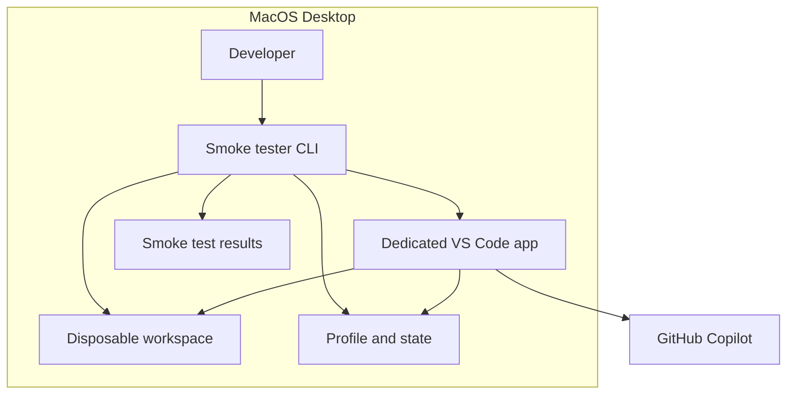
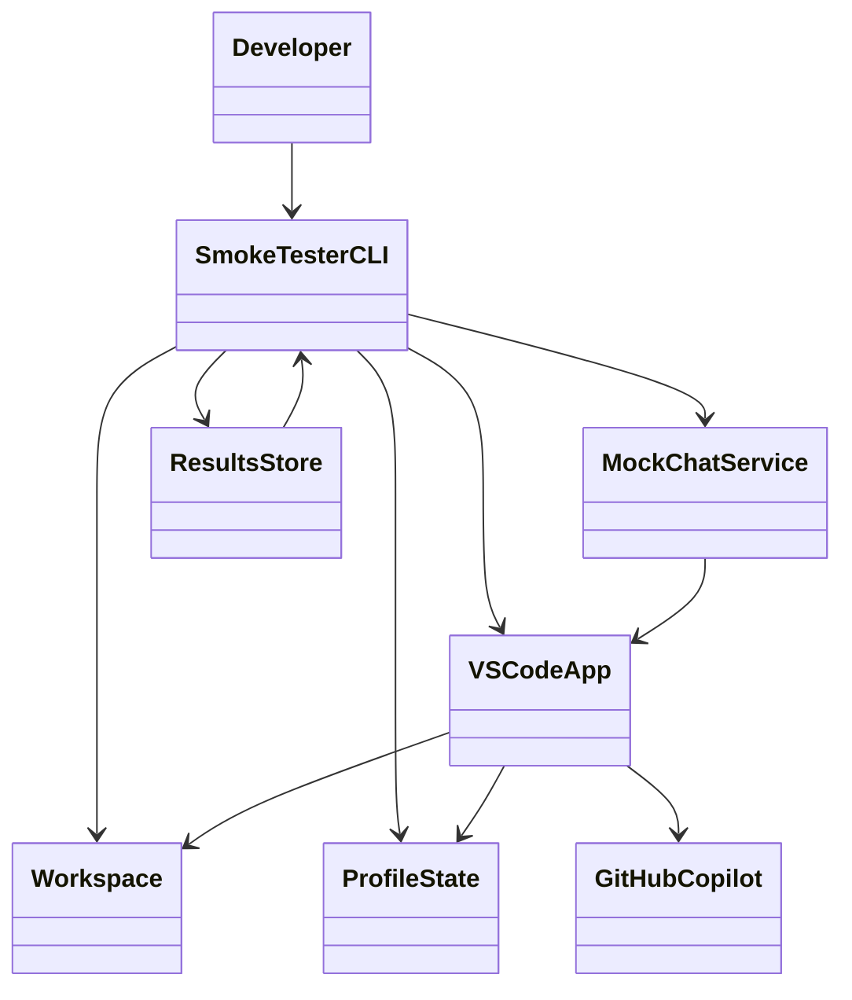
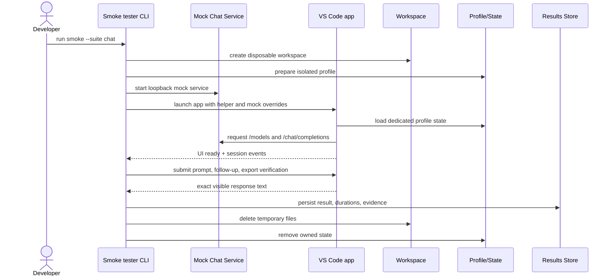
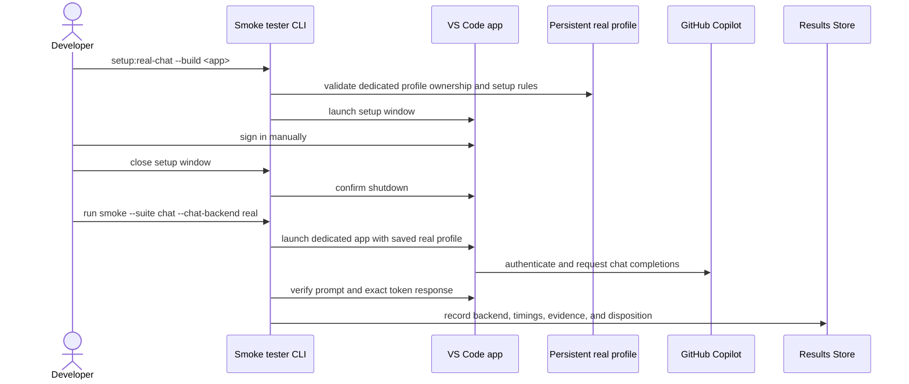
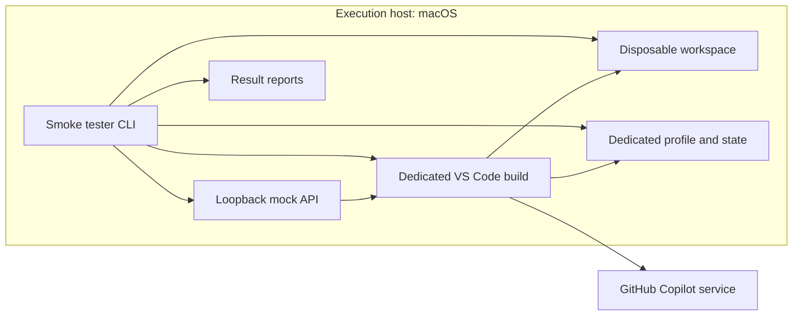

# VS Code Smoke Tester Solution Design

## 1. Executive Summary

This solution is a dedicated VS Code smoke-test harness for validating editor operations and Copilot Chat behavior in a controlled, isolated environment. The architecture centers on a standalone TypeScript runner that launches a dedicated VS Code application instance, drives the workbench through Playwright/Electron automation, and validates observable user-facing results against a disposable workspace and isolated profile.

The design supports two execution models:

- Mock-mode smoke tests: a local in-process HTTP mock service simulates Copilot Chat endpoints and synthetic responses.
- Real-backend mode: the tester opens a dedicated persistent profile for manual sign-in and validates authentic Copilot Chat behavior against the live GitHub Copilot service.

The architecture is intentionally strict about isolation and ownership. Each run reserves a dedicated report and resource directory, creates ephemeral workspace content, uses a dedicated profile or synthetic profile state, and records outcome, timings, and cleanup status separately from the application under test.

## 2. Scope and Objectives

### In Scope

- Launching a dedicated VS Code instance for test-specific execution
- Bootstrapping a disposable workspace and isolated profile/state
- Running editing and Chat smoke checks through real editor UI automation
- Supporting a mock local backend for deterministic validation
- Supporting a real Copilot backend with profile setup and manual sign-in
- Capturing evidence, reporting, cleanup, and exclusive resource ownership

### Out of Scope

- Rebuilding or modifying the VS Code application under test
- Broad end-to-end product testing beyond smoke scenarios
- Automatic handling of authentication or MFA
- Unbounded or background telemetry retention beyond run-local evidence
- Generic multi-user/shared desktop orchestration

### Objectives

1. Confirm that the editor can open, save, reopen, and export workspace files in a known-good state.
2. Verify that a fresh local Chat interaction can complete a response cycle in the same IDE session.
3. Enforce isolation through disposable workspaces, dedicated profiles, and run-scoped results.
4. Support deterministic mocked execution for CI-like checks and targeted real-backend validation when prerequisites are present.
5. Fail closed on missing user state, stale session binding, or cleanup uncertainty.

## 3. Architecture Context

The system sits within the broader macOS desktop environment and is designed to validate a shipped VS Code application with bundled Copilot Chat behavior. The architecture includes one external dependency: the GitHub Copilot service used only in real-backend mode. All other test logic is local to the runner and the dedicated app instance.

The CALM model identifies the following primary building blocks:

- Internet: external service boundary for GitHub Copilot
- MacOS Desktop: host environment containing the smoke tester, app, workspace, profile, and results
- Developer: operator who invokes smoke commands and performs manual sign-in
- Smoke tester CLI: orchestrator and evidence recorder
- Dedicated VS Code application: editor and UI automation target
- Disposable workspace: temporary editing fixtures and export content
- Dedicated profile and state: isolated app settings and session state
- Smoke test results: run artifacts and ownership records

## 4. Stakeholders and Actors

### Developer

The developer is the primary operator. They start test commands, reserve the desktop environment, configure the dedicated build, and trigger manual sign-in for real-profile setup. Their role is operational and policy-aware rather than implementation-level.

### Smoke Tester CLI

The CLI is the orchestration component. It:

- validates compatibility and app selection
- creates or validates a disposable workspace
- prepares the profile and synthetic or persistent configuration
- launches VS Code with constrained environment variables and test-specific settings
- runs the selected suites
- captures JSON and text evidence
- performs cleanup and release of exclusive resources

### Dedicated VS Code Application

This is the application under test. It hosts the editor, local Copilot Chat workbench, and helper extension that exposes automation commands and UI-driven behavior. It uses a dedicated profile and local session state.

### GitHub Copilot

The external backend is only used for real Chat checks. The runner must verify a valid authenticated session and validate the application’s interaction with the service. It does not assume hidden fallback behavior and fails closed on missing or expired auth.

## 5. Functional Requirements and Use Cases

### Core Functional Requirements

1. The runner must launch the chosen VS Code build in a dedicated, isolated environment.
2. It must validate the IDE is ready before executing UI actions.
3. It must support editing scenarios that save and reopen files and validate byte-for-byte correctness.
4. It must support Chat scenarios that open a fresh local session, submit prompts, and validate exact message and response text.
5. It must support both mock and real chat backends, with strict differences in profile and URL configuration.
6. It must record exact outcomes, timings, request counts, and cleanup state.
7. It must fail when cleanup is uncertain or resource ownership cannot be confirmed.

### Use Cases

#### UC-1: Editing smoke check

- Developer invokes the runner with the editing suite.
- The harness creates temporary workspace fixtures.
- VS Code opens, edits, saves, and reopens files.
- The harness checks file contents and final state.
- Disposables are cleaned up and the run result is written.

#### UC-2: Chat smoke check with mock backend

- The runner starts the in-process mock API on loopback.
- It launches VS Code with the synthetic auth/profile context.
- The helper opens a fresh Chat session and submits a prompt and follow-up.
- The harness verifies visible prompts, exact synthetic replies, and the matching mock request lifecycle.
- Results are written and resources are removed.

#### UC-3: Real profile setup

- Developer runs `setup:real-chat` for the pinned VS Code build.
- The harness checks profile ownership and reserved desktop state.
- It launches a dedicated setup window so the developer can sign in manually.
- The app is closed and the reserved setup resources are released while preserving the authenticated profile.

#### UC-4: Real backend smoke check

- The user launches Chat or combined verification with the real backend.
- The harness uses the dedicated persistent profile and validates a successful guided session.
- The result asserts an exact prompt/session model and matching response text.
- Any missing auth, expired sign-in, or response mismatch becomes a failed or blocked outcome.

## 6. Solution Overview

The solution is implemented as a small orchestration layer around a test-owned VS Code instance. The system is deliberately deterministic and opinionated: it uses stable command APIs, fixed compatibility checks, loopback endpoint overrides, isolated config directories, and strict ownership artifacts. It does not assume cross-platform equivalence or a shared desktop environment.

The central design decision is to treat the app under test as a black-box runtime. All validation is based on UI-visible behavior, persisted workspace state, and runtime evidence recorded by the harness. This reduces coupling to internal implementation details and makes the behavior testable under real application conditions.

Key characteristics:

- isolated execution per run
- dedicated profile/state management
- deterministic mock simulation
- manual real-auth branch
- result-driven cleanup and failure disposition
- exact byte/text checks rather than approximate UI checks

## 7. Logical Architecture

This logical view focuses on responsibilities rather than implementation detail.

### Logical responsibilities

- SmokeTesterCLI: app launch, environment setup, suite selection, state ownership, evidence recording
- Workspace: temporary files, fixtures, and exported chats for validation
- ProfileState: user data, settings, auth state, renderer logs, extension config, session metadata
- MockChatService: synthetic model/policy/token/session behaviors for deterministic Chat tests
- VSCodeApp: actual UI and backend surfaces exercised by the smoke checks
- ResultsStore: JSON and text outcomes, cleanup status, resource paths, and failure reasons

## 8. Component Interaction Flows

The default flow for a mock Chat run is a strong example of the end-to-end architecture.

### Real-profile flow

## 9. Data, State, and Storage

The solution manages both transient and persistent data carefully:

- Workspace files: temporary editing fixtures and exported chat content
- Profile directories: user-data, extensions, renderer logs, and session state
- Result reports: JSON and text results, time stamps, durations, dependency versions, request counts, and cleanup reasons
- Reservation metadata: a shared lock file ensures exactly one run owns a given execution target at a time

### Storage model

| Area | Purpose | Lifecycle |
|---|---|---|
| /private/tmp/ide-smoke-* | Disposable workspace and state root | Reused for one run, then removed on success or retained on failure |
| profiles/smoke-real-chat/ | Persistent real-chat profile | Preserved across runs and only modified by owner workflow |
| reports/smoke/.reservation | Exclusive execution reservation | Created at run start, released on shutdown |
| reports/smoke/<run-id>/ | Result evidence | Retained for investigation and failure analysis |

### Data integrity principles

- File validation compares exact bytes rather than approximate visual expectations.
- Chat validation asserts exact prompt and response text including unique markers.
- Session identity and response counts are checked to prevent stale or duplicate messages from passing.
- Result evidence keeps only the test-owned transcript and selected logs, not unrelated credentials or browser traces.

## 10. Security, Privacy, and Compliance

This design does not use broad user data access or shared authentication state. Instead, it isolates each run to a reserved environment and intentionally avoids capturing screenshots or traces for real authentication flows.

### Security controls

- Dedicated profiles avoid mixing test data with user settings.
- Mock mode uses loopback overrides, synthetic credentials, and in-memory secret storage.
- Real mode preserves authenticated state only behind a dedicated persistent profile that the harness treats as explicitly owned.
- The harness checks resource ownership and rejects unowned or symlinked profile paths.
- Early failure and clean-up uncertainty are treated as a harness error rather than silently continuing.

### Privacy considerations

- Real-profile and real-chat runs capture no screenshots or Playwright traces.
- The harness avoids exporting unrelated content and only records the active test Chat and required evidence.
- Existing local profile data remains private and is retained outside distributed artifacts.

### Compliance posture

The system is designed to minimize data exposure and treat authentication as an explicit manual step. This keeps the harness aligned with secure local test execution and avoids automated credential capture.

## 11. Deployment Architecture

The deployment model is local and execution-scoped. There is no distributed service or cloud orchestrator; the smoke tester is a local TypeScript process running on macOS and launching a dedicated VS Code instance.

### Deployment characteristics

- Local host execution only
- One dedicated app instance per run
- One run reservation at a time
- Local binned temp folders for isolation
- Manual sign-in only for real-mode authentication
- Compatibility gate for host version, Node version, and VS Code build requirements

## 12. Operations, Monitoring, and Recovery

### Monitoring

The smoke tester writes explicit result evidence to JSON and text files, including:

- selected suites and scope
- backend type (mock or real)
- execution durations
- request counts and outcomes
- cleanup disposition
- retained resource path if the run terminated abruptly

### Recovery

Recovery is intentionally conservative. If a run fails or leaves an application in an uncertain state, the harness retains the reservation and resource data. The developer is expected to inspect the report and profile state before manually clearing the reservation or reusing the profile.

### Operational runbook

1. Confirm an unlocked, reserved desktop and correct build path.
2. Run the selected suite with an explicit `--build` path.
3. Inspect `result.json` and `result.txt` for pass/fail/harness status.
4. If cleanup failed or the app remained active, inspect the run directory and reservation state before retrying.
5. For real mode, validate the dedicated profile is closed before the next test.

## 13. Risks, Assumptions, and Next Steps

### Risks

- Profile state drift or stale authentication can invalidate a real Chat result.
- UI timing or hidden session state can cause false negatives if the app changes.
- Cleanup uncertainty can leave the environment in a state that looks successful but is not safe to reuse.
- Mock-mode behavior may not reflect real Chat semantics if the product changes outside of the tested contract.

### Assumptions

- macOS is the primary execution environment for the qualified scenarios.
- The VS Code build and bundled Copilot Chat version remain compatible with the harness contract.
- The developer has an unlocked dedicated desktop for GUI execution.
- Real-mode authentication remains a manual step and is not automatically automated.

### Recommended next steps

1. Keep the mock backend as the default for deterministic smoke validation.
2. Treat real-backend verification as a separate, explicit qualification gate.
3. Preserve run evidence and owner records for every execution.
4. Expand coverage only after compatibility is revalidated against new host or VS Code versions.
5. Continue to enforce strict failure and cleanup semantics so the harness remains trustworthy under abnormal conditions.

---

This design reflects the architecture represented in the CALM model for the VS Code smoke tester, with emphasis on isolated execution, observable validation, dedicated state ownership, and deterministic mock/real backend coverage.
