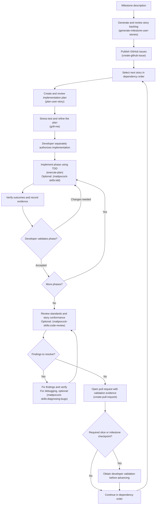

# Development workflow

Use these skills to move from a milestone description to reviewed implementation. Skill invocations are agent prompts, not shell commands.

1. **Generate the backlog — [generate-milestone-user-stories](../.agents/skills/generate-milestone-user-stories/SKILL.md).** Invoke, for example, `$generate-milestone-user-stories milestone=2`. The skill uses the proposal for scope and the Milestone 1 backlog as its structural model, asks about consequential decisions, and writes or refines `specifications/ide-copilot-milestone<N>-user-stories.md`. Review the stories, acceptance criteria, dependencies, evidence requirements, and developer gates.
2. **Publish the stories — [create-github-issue](../.agents/skills/create-github-issue/SKILL.md).** Input: the reviewed `specifications/ide-copilot-milestone<N>-user-stories.md` file produced in step 1. For example: “Use `$create-github-issue` to create one GitHub issue per story in `specifications/ide-copilot-milestone2-user-stories.md`.” The skill uses the repository issue template and preserves story IDs, acceptance criteria, dependencies, evidence requirements, and developer gates.
3. **Plan the next eligible story — [plan-user-story](../.agents/skills/plan-user-story/SKILL.md).** Supply its issue or specification reference. The skill saves a technical plan under `docs/implementation-plans/`, with phases, tasks, verification, and developer checkpoints. Review the plan before execution.
4. **Stress-test the plan — `grill-me`.** Before execution, use the skill to challenge assumptions, surface missing decisions, and refine the saved plan. If the installed plugin exposes this skill as `mattpocock-skills:grilling`, use that name. Resolve the questions and review the revised plan before authorizing implementation.
5. **Authorize and implement the plan — [execute-plan](../.agents/skills/execute-plan/SKILL.md).** Separately instruct the agent to execute the approved Markdown plan, for example `$execute-plan docs/implementation-plans/M1-02.md`. The skill checks off tasks only after completion and verification, records evidence in the plan, and stops at the end of every phase for developer validation, including the final phase. Use `mattpocock-skills:diagnosing-bugs` for debugging or `mattpocock-skills:tdd` when test-first development is requested and those plugin skills are available.
6. **Review the changes — `mattpocock-skills:code-review`.** When available, use this plugin skill to review repository standards and conformance to the originating story. Resolve findings and present validation evidence for developer review; code review does not replace the required developer validation.
7. **Open a pull request — [create-pull-request](../.agents/skills/create-pull-request/SKILL.md).** Request a PR using the repository template, describing the resulting behavior and validation evidence.

Repeat planning, implementation, review, and PR creation in dependency order. Stop at each required developer checkpoint before advancing to the next phase, slice, or milestone. Future milestone backlogs may be drafted early, with prerequisite approvals recorded explicitly.

Generating a backlog, creating issues, and approving a plan do not authorize implementation. Implementation requires a separate developer instruction. Plugin skills named above are optional tooling and must be available in the agent session; the linked repository-local skills live in this checkout.
