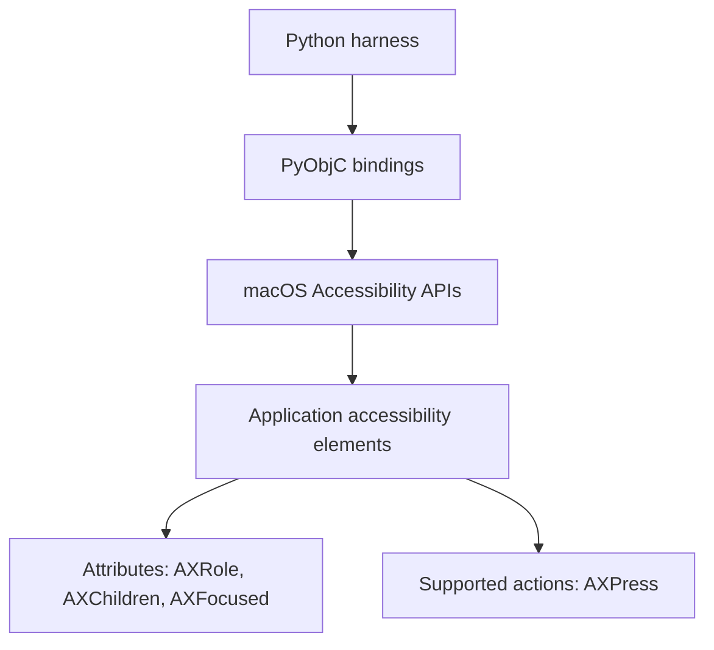

# AX: macOS Accessibility

> **Historical reference — fresh-start reset (2026-10-22):** This document preserves prior planning, research, decisions, and recorded results. Implementation, test, and execution claims refer to the previous harness; that source and its execution reports were removed from this branch. Commands and approvals here do not establish current functionality or authorize resumption. See [the current README](../../README.md) for the retained environment and current scope.


This document summarizes some of the difficulties encountered while using
PyObjC to interact with the VS Code IDE through macOS Accessibility APIs.
It introduces the relationship between PyObjC and AX, then uses recorded project
examples to explain problems with identifying controls, reading their state,
maintaining valid element references, and confirming that actions had the
intended effect. The examples distinguish observed failures from unresolved
causes and show why successful API calls still require verification of UI outcomes.

**AX refers to Accessibility**, specifically the macOS Accessibility APIs used
to inspect and interact with application interfaces. It is the prefix used in
names such as `AXWindow`, `AXFocused`, and `AXPress`.

In this project, AX lets the harness locate VS Code windows and controls, inspect
their state, and perform supported interface actions.

## Common terms

| Term | Meaning |
| --- | --- |
| `AXWindow` | A window role. |
| `AXButton` | A button role. |
| `AXTextArea` | A text-area role; it might identify an editor or Chat input, depending on its context. |
| `AXRole` | An attribute describing an element's kind, such as `AXButton`. |
| `AXChildren` | An attribute exposing an element's child elements. |
| `AXFocused` | An attribute indicating whether an element has keyboard focus. |
| `AXPress` | A supported action that presses a control. |

Roles describe what an element is, attributes describe its properties, and
actions describe what an accessibility client can ask it to do. An action or
attribute is usable only when the target element supports it.

## The AX tree

The **AX tree**, or accessibility tree, is the hierarchy of elements an application
exposes to accessibility tools. A simplified example is:

```text
Application
└── Window
    ├── Toolbar
    │   └── Button
    └── Chat region
        └── Text area
```

This illustrates the hierarchy; it is not a verified VS Code selector structure.
Finding an `AXTextArea` alone does not establish that it is the Copilot prompt.
The harness must also establish its containing region and owned window.

## How Python uses AX in this project

**PyObjC** connects Python to native macOS APIs. The macOS worker imports
`ApplicationServices`, commonly aliased as `AX`, and calls functions such as
`AXUIElementCopyAttributeValue` to inspect elements. The historical discovery
probe also uses `AXUIElementPerformAction` to invoke supported actions.



PyObjC makes native functions, element references and returned values usable
from Python. macOS and the target application supply the accessibility elements
and their behavior. `AX` below is simply the Python alias for `ApplicationServices`.

```python
import ApplicationServices as AX


def inspect_windows_and_focus(pid, control):
    # Obtain an accessibility reference to the application.
    application = AX.AXUIElementCreateApplication(pid)

    # Read its windows attribute through the PyObjC bindings.
    error, windows = AX.AXUIElementCopyAttributeValue(
        application, "AXWindows", None
    )
    if error != 0:
        raise RuntimeError("Could not read application windows")

    # Check whether the identified control supports setting focus.
    error, settable = AX.AXUIElementIsAttributeSettable(
        control, "AXFocused", None
    )
    if error != 0 or not settable:
        raise RuntimeError("Control does not support setting focus")

    # Request a change to the control's focus attribute.
    error = AX.AXUIElementSetAttributeValue(control, "AXFocused", True)
    if error != 0:
        raise RuntimeError("Focus request failed")

    return windows
```

This illustrative function assumes `pid` identifies the intended test application
and `control` is an already located accessibility element belonging to its owned
window. It omits element discovery, ownership revalidation, deadlines and focus
readback; those checks belong to the harness. A successful setter call still
requires independent confirmation of focus. The example is explanatory and has
not been executed as part of this documentation change.

Examples in this checkout:

- Native VS Code worker (historical path: `../../src/ide_smoke/platforms/macos/vscode_worker.py`; removed from this branch).
- Historical UI discovery probe (historical path: `../../scripts/spikes/m1_00/discover.py`; removed from this branch).

## Why AX appears in testing problems

Automation depends on the elements and properties VS Code exposes. Controls can
be missing or ambiguous, element references can become stale when the interface
changes, and focus may be unconfirmed even when a control exists.

Accessibility permission, a usable graphical session, and application accessibility
settings can affect inspection. In the qualified M1-00 setup,
`editor.accessibilitySupport=on` was needed for reliable editor-text readback;
`AXManualAccessibility` alone did not establish that behavior. See the
M1-00 evidence (historical path: `../reports/M1-00-phase1.md`; removed from this branch).

An AX action returning successfully does not by itself prove the intended test
outcome. Focus needs observable confirmation, an IDE edit needs independent disk
verification, and Chat UI readiness does not establish authentication or a
completed response. AX findings therefore need to be interpreted within the
specific test's scope and recorded evidence.

### Different kinds of failure need different evidence

| Problem | Why it matters | Evidence needed |
| --- | --- | --- |
| Ambiguous element identity | An editor and Chat input can both appear as text areas. A matching role alone can select the wrong control. | The expected containing region and association with the owned application/window. |
| Stale element reference | A reference obtained before a UI transition may no longer identify a valid element afterward. | A fresh, bounded observation of the current tree and target. |
| Incomplete text exposure | The accessibility input may expose a proxy rather than the full editor buffer. An empty value can be misleading. | Qualification of the application's accessibility mode and independent confirmation of the intended content. |
| Unconfirmed focus | A setter or press can return success while the expected field still reports no focus. Typing afterward could reach an unintended control. | Focus readback for the identified control and confirmation of the intended foreground application. |
| Observation/action timing | The UI or foreground application can change between checking a target and acting on it. | Revalidation close to the action, a reserved desktop, and verification of the resulting state. These reduce uncertainty without eliminating the race. |

The harness therefore has three distinct questions to answer: **Did it identify
the right element? Did the accessibility call succeed? Did the intended user-visible
outcome occur?** One successful API return cannot answer all three.

### Recorded example: Quick Open accepted actions but focus remained unconfirmed

During M1-05 editor qualification on 2026-10-21, the harness opened VS Code's
Quick Open interface to enter a file path. A structural observation found exactly
one empty `AXTextField` with the expected Quick Open label and owned-window
association. However, the input's focus check failed; an `AXStaticText` element
was the only element observed reporting focus at that checkpoint.

Four separately recorded attempts investigated the same focus problem:

| Attempt | Observation |
| --- | --- |
| Set `AXFocused=True` on the identified field. | Input focus remained unqualified. |
| Enable the explicitly authorized temporary `editor.accessibilitySupport=on` setting. | The focus setter returned `0`, but immediate focus readback remained false. |
| Allow bounded time for that single focus request to complete. | Focus remained false. |
| Invoke the field's supported `AXPress` action once, then wait for confirmation. | `AXPress` returned `0`, but focus remained false. |

This is the practical limitation of the earlier Python example: checking
`error == 0` establishes that the call returned without an AX error, but it is
insufficient to establish that the intended field now has keyboard focus.
The harness refused to enter the path while that condition was uncertain.
No file replacement or Save success followed from these attempts, and work
stopped at the repository's four-unsuccessful-fix-round checkpoint.

The evidence establishes **unconfirmed focus**, rather than a proven cause in
PyObjC, macOS, or VS Code. Enabling the accessibility setting had resolved a
different text-readback problem in M1-00; that earlier result did not establish
that the same setting would resolve Quick Open focus.

See the M1-05 focus-attempt evidence (historical path: `../reports/M1-05-phase1.md#four-unsuccessful-input-focus-fixes--guidance-checkpoint`; removed from this branch).
These are historical observations, not instructions to resume the held work.

### Related example: a reference became invalid during inspection

Earlier M1-05 attempts also encountered error `-25202`, identified by the
installed framework as `kAXErrorInvalidUIElement`, while reading `AXRole`.
An element reference could no longer be used reliably at that observation point.
The investigation introduced bounded reacquisition of read-only observations;
it did not authorize replaying a mutation whose completion was uncertain.

Fresh observation eventually reached Quick Open without that stale-element
error, but the separate focus check still failed. Resolving one AX problem
therefore did not establish that the entire editor workflow worked. See the
M1-05 investigation history (historical path: `../reports/M1-05-phase1.md#probe-tdd-and-initial-host-investigation`; removed from this branch).

Synthetic tests can check how the harness handles these reported states,
deadlines and refusals. Actual host checks are needed to establish what the
target VS Code UI exposes and whether an action has the required effect.
