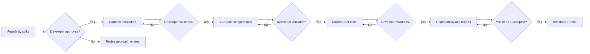
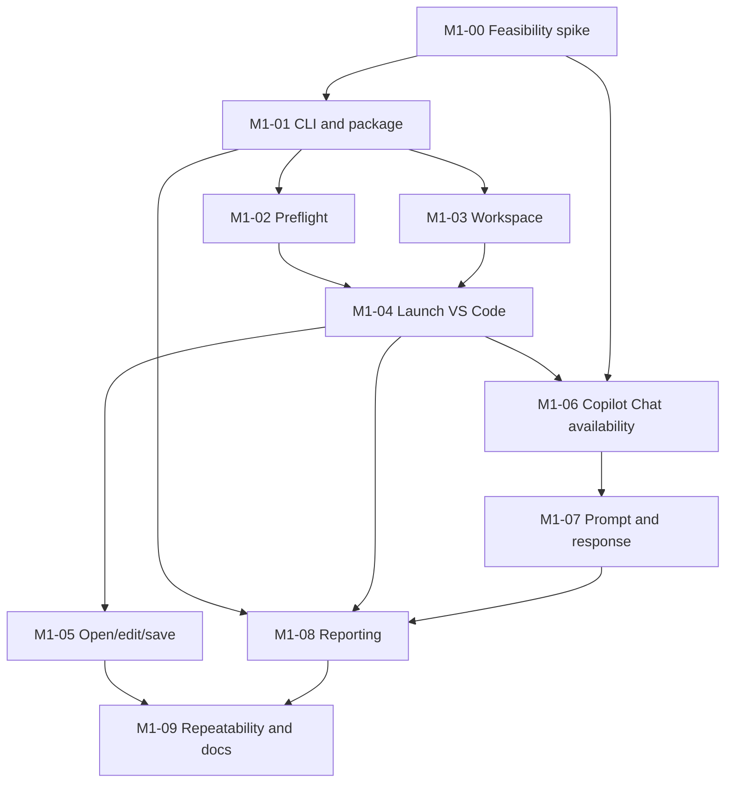

# IDE Smoke Test Harness — Milestone 1 User Stories

**Status:** Draft backlog for review and refinement  
**Source:** `ide-copilot-smoke-harness-proposal.md`  
**Target:** macOS; VS Code only; GitHub Copilot Chat  
**Authentication:** Existing signed-in session in a dedicated, persistent test profile  
**Execution model:** Local, attended setup followed by repeatable unattended runs  
**Out of scope:** IntelliJ IDEA, release monitoring, automatic IDE upgrades, Copilot inline completion, agent mode, comprehensive code-generation tests, local native compilation, custom native helpers, and compiler toolchain installation.

## 1. Milestone objective and success criteria

The harness targets VS Code or IntelliJ IDEA and selected extensions. This milestone proves the initial combination: VS Code and GitHub Copilot Chat on macOS. Other extensions and IDE/platform combinations remain later scoped work.

Deliver a local proof of concept that starts a **test instance of VS Code**, opens a disposable workspace, edits and saves a file, opens **GitHub Copilot Chat**, submits a simple prompt, and determines whether a completed response was received. The run must produce clear pass/fail/blocked results and useful diagnostics without changing the user's regular VS Code settings or projects.

Milestone 1 is complete when:

1. The user can invoke a documented command, such as `ide-smoke run --ide vscode`, to run tests T01–T05.
2. An initial, explicitly documented one-time setup establishes the dedicated profile and signed-in Copilot session.
3. Subsequent runs require no manual interaction **provided** the macOS graphical session is usable, permissions remain granted, and authentication is valid.
4. The tests verify observable outcomes, not only that UI actions were sent.
5. Failures and blocked prerequisites are distinguishable; a failing run returns a nonzero exit code and preserves diagnostic evidence.
6. The developer reviews evidence from repeated runs on an unchanged installation and explicitly approves Milestone 1 before Milestone 2 begins.

### Logical smoke tests

| ID | Test | Observable pass criterion |
|---|---|---|
| T01 | Launch VS Code | Expected VS Code instance/window becomes usable within timeout |
| T02 | Open fixture workspace/file | Correct disposable workspace and target file are open |
| T03 | Edit and save file | On-disk file content matches expected text after an IDE save |
| T04 | Open Copilot Chat | Chat UI is visible and available for interaction; authentication problems are separately classified |
| T05 | Send Copilot prompt | A new assistant response to this run's prompt is detected and completed within timeout; content satisfies a defined assertion |

## 2. Delivery strategy

Apply YAGNI (You Aren’t Gonna Need It): add tools, dependencies, and abstractions only when a current acceptance criterion demonstrates the need. Use prebuilt applications and Python, and pure-Python packages or compatible prebuilt wheels. Disable dependency builds from source during installation. Do not install Xcode, Apple’s Command Line Tools, compilers, or SDKs for the harness. If an automation approach requires native compilation, revisit the dependency or approach.

Use short, reviewable implementation slices. Each story has acceptance criteria and validation evidence. **Do not advance automatically from one implementation slice to the next**: the developer reviews the results of each slice. A feasibility spike precedes the main implementation because Copilot Chat automation through macOS Accessibility APIs is not yet proven.



## 3. User stories

### Spike M1-00 — Validate Copilot Chat automation feasibility

**Priority:** Critical | **Type:** Time-boxed research spike | **Dependencies:** None

**As a** harness developer, **I want** to establish which VS Code and Copilot UI interactions can be automated on my macOS installation, **so that** the design relies on demonstrated capabilities rather than assumptions.

**Acceptance criteria**

- [ ] Record macOS, architecture, VS Code, Copilot extension, and Python versions; note the VS Code distribution and install paths.
- [ ] Demonstrate that the proposed automation dependencies install without native source builds on the target host, with source builds disabled. Select only what the spike needs; treat PyObjC as a candidate subject to compatible prebuilt wheel availability. If no approach meets this constraint and the required UI checks, report no-go and document the limitation.
- [ ] Verify that a test VS Code instance can be launched without taking over the user's regular workspace; document any instance/profile isolation caveats.
- [ ] Inspect macOS Accessibility representation of VS Code and Copilot Chat; record selectors or other stable interaction methods actually observed.
- [ ] Demonstrate opening Copilot Chat, entering a prompt, and reading a response using the proposed automation approach, or explicitly record which steps are not feasible.
- [ ] Investigate how to determine **response completion**, distinguish a fresh response from previous chat history, and detect an authentication-required state.
- [ ] Validate that a dedicated test profile can retain a signed-in Copilot session across IDE restarts without copying credentials or bypassing authentication.
- [ ] Record required Accessibility, Automation, Screen Recording, and Keychain permissions **as observed**, not as assumed requirements.
- [ ] Produce a feasibility decision: **go**, **go with limitations**, or **no-go**, with a fallback option and known risks.

**Evidence:** Short spike report, redacted accessibility observations, proof-of-concept scripts, and one manual/automated demonstration. Never store tokens or private chat content in the repository.

**Developer gate:** Approve the selected UI automation strategy before implementing the Chat adapter.

---

### Story M1-01 — Bootstrap the Python project and CLI

**Priority:** Must | **Dependencies:** M1-00 approved

**As a** developer, **I want** a reproducible local Python project with a command-line entry point, **so that** I can run and extend the harness consistently.

**Acceptance criteria**

- [ ] Define a Python package and development dependencies in `pyproject.toml` with documented setup steps.
- [ ] Include only dependencies justified by current stories; lock the selected versions and document installation with dependency source builds disabled. Verify that setup needs no compiler toolchain or native source builds on the target host.
- [ ] Provide `ide-smoke --help` and `ide-smoke run --ide vscode`; unimplemented operations fail clearly rather than silently succeeding.
- [ ] Read and validate YAML configuration; report invalid keys, missing paths, and invalid timeout values with actionable errors.
- [ ] Provide structured logging with run identifier and timestamps.
- [ ] Define distinct outcomes: `PASS`, `FAIL`, `BLOCKED`, and optionally `SKIP`.
- [ ] Add unit tests for configuration parsing, CLI argument validation, and result classification.

**Evidence:** CLI output and passing unit-test report.

---

### Story M1-02 — Preflight macOS and test-profile readiness

**Priority:** Must | **Dependencies:** M1-01

**As a** developer, **I want** the harness to check its environment before starting GUI tests, **so that** missing prerequisites do not appear as IDE regressions.

**Acceptance criteria**

- [ ] Verify the configured VS Code executable exists and is runnable.
- [ ] Check that the intended macOS graphical session is usable; fail as `BLOCKED` if the UI cannot be driven.
- [ ] Check the required automation permissions using feasible documented checks or a minimal interaction probe; do not claim a permission was verified if it was not.
- [ ] Validate test-profile paths and the presence of the expected Copilot extension; distinguish missing extension from authentication failure.
- [ ] Do not automate passwords, MFA, or Keychain extraction.
- [ ] Provide a human-readable one-time setup guide for granting permissions and signing in to Copilot.

**Evidence:** Successful preflight and at least one simulated/controlled blocked-preflight test.

---

### Story M1-03 — Manage disposable workspace and safe cleanup

**Priority:** Must | **Dependencies:** M1-01

**As a** developer, **I want** a fresh fixture workspace for every run, **so that** smoke tests are reproducible and cannot damage my real projects.

**Acceptance criteria**

- [ ] Create a unique temporary workspace per run containing a known text or Python file.
- [ ] Keep workspace lifecycle separate from the persistent authenticated IDE profile.
- [ ] Enforce safe-path checks: cleanup must not delete user projects, home directories, or paths outside the harness-owned workspace root.
- [ ] Retain the workspace or a sanitized snapshot on failure when configured.
- [ ] Unit-test workspace creation, fixture content, and cleanup safeguards.

**Evidence:** Workspace manifest, test logs, and cleanup safety tests.

---

### Story M1-04 — Launch and identify the VS Code test instance (T01)

**Priority:** Must | **Dependencies:** M1-02, M1-03

**As a** developer, **I want** the harness to launch a test-specific VS Code instance and wait for readiness, **so that** subsequent actions target the correct IDE.

**Acceptance criteria**

- [ ] Launch the configured VS Code executable with the dedicated user-data and extensions directories, subject to feasibility-spike findings.
- [ ] Open the run's disposable workspace.
- [ ] Detect the expected VS Code process/window and readiness within a configurable timeout.
- [ ] Avoid attaching to or closing unrelated user VS Code windows.
- [ ] Record startup duration and distinguish startup failure from timeout.
- [ ] Close only the test-owned instance during cleanup, even after test failure.

**Evidence:** T01 run output, startup timing, and controlled timeout test.

---

### Story M1-05 — Open, edit, and save a file (T02–T03)

**Priority:** Must | **Dependencies:** M1-04

**As a** developer, **I want** the harness to manipulate a file through the VS Code editor, **so that** I can confirm basic IDE functionality after an update.

**Acceptance criteria**

- [ ] Open a known file in the disposable workspace and verify the intended editor/file is active.
- [ ] Replace or insert text **through an IDE interaction**, not by writing the expected result directly to disk.
- [ ] Invoke Save through the IDE and wait for persistence.
- [ ] Independently read the file from disk and compare its content to the expected bytes or normalized text.
- [ ] Fail with a useful diff or expected/actual summary if verification fails.
- [ ] Make test reruns independent by recreating the fixture workspace.

**Evidence:** Passing T02/T03 tests and a controlled negative test proving the disk assertion catches an incorrect save.

**Developer gate:** Approve reliable T01–T03 operation before integrating Copilot Chat.

---

### Story M1-06 — Open Copilot Chat and detect availability (T04)

**Priority:** Must | **Dependencies:** M1-00, M1-04

**As a** developer, **I want** the harness to open Copilot Chat and recognize whether it is ready, **so that** missing extensions or expired sessions are reported accurately.

**Acceptance criteria**

- [ ] Open Copilot Chat through a verified VS Code UI interaction or supported command.
- [ ] Verify the Chat interface and prompt input are accessible.
- [ ] Detect a sign-in-required state where observable; classify it as `BLOCKED_AUTH` (a subtype of `BLOCKED`) rather than a product failure.
- [ ] Capture a bounded diagnostic artifact if Chat cannot be opened.
- [ ] Do not claim Copilot is authenticated merely because the extension is installed or Chat opens.

**Evidence:** Passing T04 and demonstration of at least one unavailable/blocked condition.

---

### Story M1-07 — Submit a Copilot Chat prompt and verify completion (T05)

**Priority:** Must | **Dependencies:** M1-06

**As a** developer, **I want** to send a small prompt to Copilot Chat and verify its completed response, **so that** I know the end-to-end IDE integration is functioning.

**Acceptance criteria**

- [ ] Start a fresh chat or otherwise reliably distinguish this run's response from existing conversation history.
- [ ] Submit a simple deterministic-intent prompt such as `Reply with exactly the word READY.` through the Chat UI.
- [ ] Detect that a **new assistant response** arrived; do not mistake echoed prompt text or stale history for success.
- [ ] Wait for completion using an observable completion signal established in M1-00; do not rely solely on a fixed sleep.
- [ ] Assert normalized response content according to an explicit rule and record the assertion outcome.
- [ ] Handle timeout, rate limit, network error, authentication-required state, and unsupported UI state distinctly where observable.
- [ ] Do not invoke a model API directly as a substitute for testing Copilot inside VS Code.
- [ ] Keep raw prompts/responses out of logs by default; allow redacted evidence for troubleshooting.

**Evidence:** Passing T05, response timing, and controlled timeout/stale-response negative tests.

**Developer gate:** Review response-detection reliability before declaring Copilot Chat automation viable.

---

### Story M1-08 — Collect diagnostics and publish test results

**Priority:** Must | **Dependencies:** M1-01, M1-04, M1-07

**As a** developer, **I want** a concise report and diagnostic artifacts for every run, **so that** I can quickly identify regressions or harness failures.

**Acceptance criteria**

- [ ] Report run ID, start/end times, macOS version, VS Code version, and Copilot extension version when discoverable.
- [ ] Report each T01–T05 result, duration, and failure/blocked reason.
- [ ] Generate a machine-readable JUnit XML report and a human-readable summary; use JSON for richer status distinctions if needed.
- [ ] Capture screenshots on GUI failures when permitted; redact or avoid exposing sensitive workspace or account data.
- [ ] Preserve relevant, sanitized logs without collecting secrets.
- [ ] Return exit code `0` only for an all-pass run; return documented nonzero codes for failures and blocked runs.
- [ ] Verify reports are still produced after exceptions and timeouts.

**Evidence:** Sample passing, failing, and blocked reports.

---

### Story M1-09 — Prove repeatability and document operations

**Priority:** Must | **Dependencies:** M1-01 through M1-08

**As a** maintainer, **I want** repeatable runs and an operator guide, **so that** I can use the harness without manually driving the IDE each time.

**Acceptance criteria**

- [ ] Run T01–T05 successfully **five consecutive times** on an unchanged VS Code/Copilot installation, with no manual interaction between runs.
- [ ] Record the exact versions, configuration, and run outcomes for each repetition.
- [ ] Demonstrate that a known failure produces a nonzero exit code and diagnostic artifacts.
- [ ] Document bootstrap, one-time sign-in, macOS permissions, run command, report location, cleanup, and common recovery steps.
- [ ] State environmental limitations: unlocked usable GUI session, granted permissions, valid authentication, network/service availability.
- [ ] Document remaining flaky interactions and their mitigation; do not suppress intermittent failures by unbounded retries.
- [ ] Obtain explicit developer acceptance of Milestone 1 before proceeding to IntelliJ support.

**Evidence:** Five-run summary, operator README, and developer sign-off.

## 4. Dependencies and suggested implementation slices



| Slice | Stories | Demonstration | Required approval |
|---|---|---|---|
| 0 — Feasibility | M1-00 | Real Copilot Chat interaction and feasibility report | UI automation approach |
| 1 — Foundation | M1-01–M1-03 | CLI, validated config, safe fixture, preflight | Safe environment and setup |
| 2 — IDE basics | M1-04–M1-05 | T01–T03, including disk assertion | Reliable file operations |
| 3 — Copilot | M1-06–M1-07 | T04–T05 with fresh completed response | Reliable Chat verification |
| 4 — Hardening | M1-08–M1-09 | Reports, negative tests, five unattended runs | Milestone 1 exit |

## 5. Proposed initial repository layout

```text
ide-smoke-harness/
├── README.md
├── pyproject.toml
├── config/
│   ├── harness.yaml
│   └── vscode.yaml
├── src/ide_smoke/
│   ├── cli.py
│   ├── config.py
│   ├── orchestrator.py
│   ├── results.py
│   ├── reporting.py
│   ├── adapters/
│   │   ├── base.py
│   │   └── vscode.py
│   ├── automation/
│   │   ├── accessibility.py
│   │   ├── keyboard.py
│   │   └── windows.py
│   └── verification/
│       ├── filesystem.py
│       └── copilot.py
├── tests/
│   ├── unit/
│   └── smoke/
│       ├── test_ide_launch.py
│       ├── test_file_operations.py
│       └── test_copilot_chat.py
├── fixtures/
│   └── python-project/
├── scripts/
│   └── bootstrap_macos.sh
├── docs/
│   ├── feasibility-spike.md
│   └── operator-guide.md
└── reports/                 # gitignored, except optional .gitkeep
```

Structure is a **proposal**; refine based on M1-00 findings. Do not implement unnecessary abstractions solely to anticipate IntelliJ.

## 6. Cross-cutting definition of done

Every implementation story is done only when:

- [ ] The change is small enough to review and linked to its story ID.
- [ ] Relevant unit or integration tests pass; GUI behavior is demonstrated where required.
- [ ] Errors and timeouts are bounded and actionable.
- [ ] No test modifies personal workspaces, production IDE profiles, or credential stores.
- [ ] Logs and artifacts do not expose secrets or unnecessary account/chat data.
- [ ] Setup or behavior changes are documented.
- [ ] New tools and dependencies serve a current acceptance criterion and install without compiler tooling or native source builds.
- [ ] The developer reviews the results and approves the slice before the next slice begins.

## 7. Known uncertainties and decisions to resolve

| Topic | Current assumption / question | Resolution point |
|---|---|---|
| UI selectors | macOS Accessibility can reach Copilot Chat controls | M1-00 |
| Automation dependencies | The selected approach installs using pure Python or compatible prebuilt wheels with source builds disabled | M1-00/M1-01 |
| Completion detection | Chat provides an observable end-of-response state | M1-00 |
| Profile reuse | Dedicated VS Code profile can preserve valid sign-in across runs | M1-00/M1-02 |
| Test instance isolation | CLI flags and instance handling avoid affecting regular VS Code | M1-00/M1-04 |
| GUI session | A usable logged-in macOS desktop is available during runs | M1-02 |
| Response assertion | Exact `READY` is reliable enough, or needs normalization | M1-07 |
| Failure taxonomy | Distinguish product failure, harness failure, auth block, environment block | M1-01/M1-08 |
| Retry policy | Limit retries to explicitly justified transient conditions | M1-08/M1-09 |

## 8. Instructions for an AI coding assistant

Use this document as the **Milestone 1 product backlog**, not as proof that the proposed APIs or selectors exist.

1. **Start with M1-00 only.** Inspect the actual environment, verify the proposed automation mechanisms, and write a short feasibility report distinguishing verified findings from assumptions.
2. Present the M1-00 findings, risks, fallback choices, and a recommended implementation plan. **Wait for developer approval before writing the main harness.**
3. Implement one slice at a time, in dependency order. For each slice: plan → implement → run tests → inspect results → summarize evidence and unresolved issues → **wait for developer validation**.
4. Use deterministic checks for filesystem operations; use explicit observable UI signals for Copilot Chat. Never treat an API-only Copilot response as evidence that the IDE extension works.
5. Do not expand into IntelliJ, automatic version detection, background scheduling, or Copilot agent/code-edit workflows during Milestone 1 without an explicit scope change.
6. When an assumption proves false, propose a design change and its trade-offs rather than silently substituting a weaker test.

### Suggested first prompt

> Review `ide-copilot-smoke-harness-proposal.md` and `ide-copilot-milestone1-user-stories.md`. Focus **only on M1-00**, the macOS VS Code + GitHub Copilot Chat automation feasibility spike. Identify the concrete checks you will perform, commands or scripts you will use, expected evidence, safety precautions, and go/no-go criteria. Flag unverified assumptions. **Do not implement the harness or proceed to M1-01 until I approve your spike plan.**
