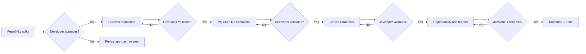
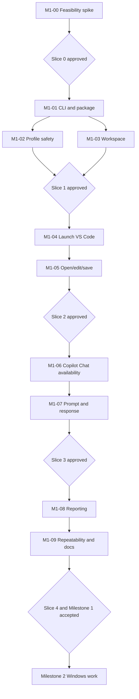

# IDE Smoke Test Harness — Milestone 1 User Stories

**Status:** Milestone 1 backlog; verified implementation and feasibility are recorded per story; overall milestone and GUI acceptance remain pending<br>
**Source:** [Harness proposal](ide-copilot-smoke-harness-proposal.md)<br>
**Target:** macOS; VS Code only; GitHub Copilot Chat<br>
**Authentication:** Existing signed-in session in a dedicated, persistent test profile<br>
**Execution model:** Existing macOS login; attended setup followed by unattended runs with exclusive desktop use<br>
**Out of scope:** IntelliJ IDEA, release monitoring, automatic IDE upgrades, Copilot inline completion, agent mode, comprehensive code-generation tests, local native compilation, custom native helpers, and compiler toolchain installation.

**Current Copilot scope — developer revision, 2026-10-20:** Only submitting one
request (`Reply with exactly the word READY.`) through the Copilot Chat UI and
requiring `response.strip() == "READY"` for its assistant response is required now. The [revised M1-00 plan](../docs/implementation-plans/M1-00.md)
and M1-00 story below govern the current task. Completion-state qualification,
cancellation/error testing, stale-history challenges,
restart reuse and repeated-run requirements are outside this work. Broader later
stories and earlier clarification tables remain future/historical design context;
they do not authorize or gate the current reduced task.

## 1. Milestone objective and success criteria

The harness targets VS Code or IntelliJ IDEA and selected extensions. This milestone proves the initial combination: VS Code and GitHub Copilot Chat on macOS. Other extensions and IDE/platform combinations remain later scoped work.

Deliver a local proof of concept that starts a **test instance of VS Code**, opens a disposable workspace, edits and saves a file, opens **GitHub Copilot Chat**, submits a simple prompt, and verifies a fresh, completed response against an explicit content assertion. The run must distinguish product failures, blocked prerequisites, and harness errors, with useful diagnostics and without changing the user's regular VS Code settings or projects.

Milestone 1 is complete when:

1. The user can invoke a documented command, such as `ide-smoke run --ide vscode`, to run tests T01–T05.
2. An initial, explicitly documented one-time setup establishes the dedicated profile and signed-in Copilot session.
3. Subsequent runs require no manual interaction **provided** the macOS graphical session is usable, permissions remain granted, authentication is valid, and the desktop is left untouched during each run.
4. The tests verify observable outcomes, not only that UI actions were sent.
5. `PASS`, `FAIL`, `BLOCKED`, and `HARNESS ERROR` are distinguishable; dependent tests that cannot run are `SKIP` with a reason. Exit code `0` requires T01–T05 to pass and cleanup to succeed; other completed run outcomes return documented nonzero codes and preserve diagnostic evidence.
6. The developer reviews five consecutive unattended passing runs on unchanged IDE/Copilot versions and relevant configuration, then explicitly approves Milestone 1 before Windows work in Milestone 2 begins.

### Qualified configuration and desktop use

Milestone 1 qualifies the developer's installed VS Code/Copilot combination on the observed macOS host. Record versions, distribution/channel, interface language, and relevant test-profile/Chat settings, including mode and model selection where observable. This evidence does not establish compatibility across other channels, languages, or models. Use a minimal, documented dedicated test profile; add personal customizations only when needed for the smoke test.

The spike must establish which configuration restrictions are necessary. Do not mandate English, a particular model, or other settings without evidence; obtain developer approval of material limitations. The existing macOS login may be used, with exclusive desktop use during each run. Concurrent everyday desktop use is outside the qualified conditions. Permit only one active harness GUI run per desktop session.

These developer-confirmed Milestone 1 decisions refine the draft proposal: a separate macOS test login is not required; raw prompts/responses remain out of logs by default despite the proposal's raw-response recording suggestion; and foundation provides basic reporting before M1-08 adds richer reports. The story criteria below govern these choices. No automation feasibility or implementation approval is established by recording them.

### Logical smoke tests

| ID | Test | Observable pass criterion |
|---|---|---|
| T01 | Launch VS Code | Expected VS Code instance/window becomes usable within timeout |
| T02 | Open fixture workspace/file | Correct disposable workspace and target file are open |
| T03 | Edit and save file | On-disk file content matches expected text after an IDE save |
| T04 | Open Copilot Chat | Chat UI is visible and available for interaction; authentication problems are separately classified |
| T05 | Send Copilot prompt | Current scope: submit `Reply with exactly the word READY.` through the UI and require `response.strip() == "READY"` for its assistant response within a bounded wait |

### Result classification and dependent tests

| Outcome | Meaning |
|---|---|
| `PASS` | The test executed and its observable assertions passed |
| `FAIL` | An observed product outcome did not satisfy an assertion, including response-content mismatch |
| `BLOCKED` | A positively identified prerequisite prevents execution, such as required sign-in or an unavailable graphical session |
| `HARNESS ERROR` | Automation cannot reliably execute or assess the test, or required cleanup fails |
| `SKIP` | A test was not executed because a prerequisite failed or was blocked; record the originating reason |

Preserve uncertainty in diagnostic reasons. Do not infer a service outage or product regression from an unexplained timeout or an unrecognized UI state. Report response-content mismatch separately from missing or incomplete responses. Stop dependent GUI actions after a prerequisite fails, report every T01–T05 test, and perform cleanup. Dependent `SKIP` results must not replace the originating failure, block, or harness error. Cleanup errors are recorded separately, preserve individual test results, and make the run nonzero even when T01–T05 pass.

## 2. Delivery strategy

Apply YAGNI (You Aren’t Gonna Need It): add tools, dependencies, and abstractions only when a current acceptance criterion demonstrates the need. Use prebuilt applications and Python, and pure-Python packages or compatible prebuilt wheels. Disable dependency builds from source during installation. Do not install Xcode, Apple’s Command Line Tools, compilers, or SDKs for the harness. If an automation approach requires native compilation, revisit the dependency or approach.

Use short, reviewable implementation slices: groups of related stories that produce a demonstration for developer validation. Each story has acceptance criteria and validation evidence. **Slice boundaries are mandatory approval gates**: complete the group, present evidence, and obtain developer validation before starting the next group. One validation can cover all completed stories in a slice. Story dependencies below include the required preceding slice approval. Plan review and execution authorization remain separate under the [repository workflow](../README.md#development-workflow); detailed per-story implementation phases have not yet been defined.

A feasibility spike precedes the main implementation because Copilot Chat automation through macOS Accessibility APIs is not yet proven. Review unresolved feasibility after one working day of active investigation, excluding time waiting for developer manual setup or responses. Present findings, uncertainty, and a recommendation; extending investigation requires a developer decision. The [repository's four-unsuccessful-fix-round limit](../AGENTS.md#validation-and-documentation) applies independently and may require stopping sooner.



## 3. User stories

### Spike M1-00 — Validate Copilot Chat automation feasibility

**Priority:** Critical | **Type:** Minimal feasibility spike | **Dependencies:** Accepted Milestone 0 environment; existing dedicated signed-in test profile

**Slice:** 0 — Feasibility

**Execution status:** Developer validated M1-00 on 2026-10-20; Slice 0 is complete. M1-01 execution requires separate authorization.
The [saved-evidence review](../docs/reports/M1-00-phase1.md#reduced-scope-result--saved-evidence-review)
establishes submission and exact `READY` matching; no additional exchange was needed.

**Scope revision:** The developer narrowed this task on 2026-10-20 to sending one
request and receiving a response. This replaces the earlier ten-criterion
M1-00 specification and its multi-launch/completion/cancellation requirements.

**As a** harness developer, **I want** to submit a simple request through Copilot
Chat and verify its response equals `READY`, **so that** I know the basic IDE integration can
be automated.

**Acceptance criteria**

- [x] AC1 — Automation enters and submits `Reply with exactly the word READY.` through the Copilot Chat UI in the dedicated VS Code instance.
- [x] AC2 — Read the associated assistant response within a bounded wait and require `response.strip() == "READY"`. Whitespace trimming only is allowed: `READY\n` passes; different capitalization, punctuation, Markdown wrapping and extra words fail. Prompt text alone does not satisfy receipt. No full-generation completion detector is required.
- [x] AC3 — Record the observed submission/receipt and exact-match result, tested configuration, minimal reproduction path and any practical prerequisite or limitation in a short sanitized report.

Reuse existing host evidence when it establishes these outcomes; another run is
not required solely because the scope changed. Keep the existing profile and
ownership/cleanup safeguards. Cancellation, negative-path/error discrimination,
stale-history challenges, restart authentication reuse,
repeated launches and other Copilot usability/feature tests are out of scope now.

**Evidence:** One observed automated request/reply exchange with exact `READY` matching, a short result
and reproduction note. Keep credentials and private content out of tracked files.

**Developer gate:** Review the reduced M1-00 result before any separately
authorized M1-01 or main-harness work. See the
[revised plan](../docs/implementation-plans/M1-00.md).

---

### Story M1-01 — Bootstrap the Python project and CLI

**Execution status:** Phase 1 and Phase 2 developer validated on 2026-10-20; M1-01 is complete. See the [Phase 2 report](../docs/reports/M1-01-phase2.md). The developer explicitly accepted Phase 2 on 2026-10-20. Slice 1 was developer validated on 2026-10-21; M1-02 profile safety is complete and developer validated on 2026-10-21, and M1-03 is complete and developer validated on 2026-10-21.

**Priority:** Must | **Dependencies:** M1-00 approved

**Slice:** 1 — Foundation

**As a** developer, **I want** a reproducible local Python project with a command-line entry point, **so that** I can run and extend the harness consistently.

**Acceptance criteria**

- [x] Define a Python package and development dependencies in `pyproject.toml` with documented setup steps.
- [x] Include only dependencies justified by current stories; lock the selected versions and document installation with dependency source builds disabled. Verify that setup needs no compiler toolchain or native source builds on the target host.
- [x] Provide `ide-smoke --help` and `ide-smoke run --ide vscode`; unimplemented operations fail clearly rather than silently succeeding.
- [x] Read and validate YAML configuration; report invalid keys, missing paths, and invalid timeout values with actionable errors.
- [x] Provide structured logging with run identifier and timestamps.
- [x] Define `PASS`, `FAIL`, `BLOCKED`, `HARNESS ERROR`, and dependent-test `SKIP` according to the classification rules above, preserving uncertainty instead of guessing at causes.
- [x] Provide a minimal saved run summary and documented exit codes before richer reporting in M1-08; include available results and reasons after blocked prerequisites, exceptions, and timeouts. Unimplemented tests cannot yield an all-pass run.
- [x] Define fail-fast behavior: stop dependent GUI actions after a prerequisite failure, preserve the originating outcome, mark dependent tests `SKIP` with reasons, and ensure cleanup is attempted.
- [x] Reject overlapping GUI-run invocations in the same desktop session with a nonzero result and actionable message before the second invocation launches an IDE or sends GUI actions; a rejected invocation must not interfere with the active run.
- [x] Add unit tests for configuration parsing, CLI argument validation, result classification, basic summaries/exit codes, dependent-test skipping, and overlap prevention.

**Evidence:** CLI output, sample basic summaries including a blocked/error outcome, a controlled overlapping-invocation check, and passing unit-test report.

**Developer gate:** The combined M1-01–M1-03 Slice 1 foundation checkpoint was developer validated on 2026-10-21. Further work requires separate authorization.

---

### Story M1-02 — Preflight macOS and test-profile readiness

**Priority:** Must | **Dependencies:** M1-01

**Slice:** 1 — Foundation

**As a** developer, **I want** the harness to validate its dedicated test-profile paths and explicit dedication, **so that** later automation targets a deliberately isolated profile while preserving personal resources and existing authentication.

**Developer-approved scope revision — 2026-10-21:** M1-02 is limited to profile
safety. All other readiness qualification is out of scope: executable identity/
runnability, session/permissions/lock state, effective settings, Copilot inventory/
authentication, and new readiness dependencies. This supersedes the earlier
limited-session snapshot scope. See the [revised plan](../docs/implementation-plans/M1-02.md).
Phase 1 qualification is verified and developer validated on 2026-10-21. The developer
accepted dedicated roots strictly beneath `<checkout>/profiles/` on 2026-10-21,
with other checkout overlap rejected and other protections retained. See the
[Phase 1 evidence](../docs/reports/M1-02-phase1.md#profile-only-qualification--resumed-2026-10-21).
The earlier Phase 2 hold was superseded by explicit authorization on 2026-10-21.
Phase 2 is **complete and developer validated on 2026-10-21**. The developer
stated: “I validate Phase 2 as complete”. P2-02 through P2-06 and P2-VALIDATION
are complete. Real-profile dedication is confirmed; explicitly
authorized marker creation, standalone safety inspection, and installed-console
verification passed. See the [Phase 2 evidence](../docs/reports/M1-02-phase2.md).
Checked criteria below have technical evidence and final developer acceptance.
GitHub issue #20 retains its earlier scope and has not been edited.

**Acceptance criteria**

- [x] Validate safe dedicated root/`user-data`/`extensions` paths and reject protected everyday locations, unsafe symlinks, and overlaps under the qualified path contract.
- [x] Require a nonsecret dedication marker; permit deliberate manual adoption of the existing dedicated profile while preserving contents and authentication. A marker never authorizes deletion.
- [x] Inspect read-only without settings/extension inventory or credential inspection; classify known unsafe/missing layouts as `BLOCKED` and indeterminate inspection as `HARNESS ERROR`.
- [x] Integrate profile validation into the guarded run with controlled saved findings and dependent skips; preserve existing foundation checks and explicit unimplemented IDE results.
- [x] Provide a human-readable profile-safety setup/adoption guide and demonstrate successful profile validation plus a controlled/simulated blocked case.

**Evidence:** The [acceptance mapping](../docs/reports/M1-02-phase2.md#acceptance-mapping-and-limitations) ties all five criteria to 294 passing non-GUI tests, synthetic console rejection, controlled inspection-error tests, real installed-console `profile_safe` followed by unimplemented exit 4, and unchanged narrow profile metadata. Authentication was not inspected or requalified; no broader readiness claim follows.

**Developer gate:** Phase 1 and final Phase 2 are developer validated on 2026-10-21; M1-02 is complete within the revised profile-safety scope. M1-03 and the combined M1-01–M1-03 Slice 1 checkpoint were subsequently developer validated on 2026-10-21. Further work requires separate authorization.

---

### Story M1-03 — Manage disposable workspace and safe cleanup

**Priority:** Must | **Dependencies:** M1-01

**Slice:** 1 — Foundation

**Execution status:** Complete and developer validated on 2026-10-21. P1-01–P1-09 passed their checks, including real-root installed-console removal/retention and 367 non-GUI tests. The developer authorized preserving the previous unmarked root by rename; no automatic adoption or repair was added. See the [plan](../docs/implementation-plans/M1-03.md) and [execution report](../docs/reports/M1-03-phase1.md). The developer explicitly validated M1-03; combined Slice 1 was separately developer validated on 2026-10-21.

**As a** developer, **I want** a fresh fixture workspace for every run, **so that** smoke tests are reproducible and cannot damage my real projects.

**Acceptance criteria**

- [x] Create a unique temporary workspace per run containing a known text or Python file.
- [x] Keep workspace lifecycle separate from the persistent authenticated IDE profile.
- [x] Enforce safe-path checks: cleanup must not delete user projects, home directories, or paths outside the harness-owned workspace root.
- [x] Retain the workspace or a sanitized snapshot on failure when configured.
- [x] Unit-test workspace creation, fixture content, and cleanup safeguards.

**Evidence:** Workspace manifest, test logs, and cleanup safety tests.

**Developer gate:** M1-03 workspace safety was developer validated on 2026-10-21. Combined M1-01–M1-03 Slice 1 was separately developer validated on 2026-10-21. The developer explicitly prohibited advancement to another phase or milestone.

---

### Story M1-04 — Launch and identify the VS Code test instance (T01)

**Priority:** Must | **Dependencies:** M1-02, M1-03; Slice 1 approved

**Slice:** 2 — IDE basics

**As a** developer, **I want** the harness to launch a test-specific VS Code instance and wait for readiness, **so that** subsequent actions target the correct IDE.

**Acceptance criteria**

- [x] Launch the configured VS Code executable with the dedicated user-data and extensions directories, subject to feasibility-spike findings.
- [x] Open the run's disposable workspace.
- [x] Detect the expected VS Code process/window and readiness within a configurable timeout.
- [x] Avoid attaching to or closing unrelated user VS Code windows.
- [x] Record startup duration and distinguish startup failure from timeout.
- [x] Close only the test-owned instance during cleanup, even after test failure.
- [x] Preserve the authenticated profile during cleanup. If the test-owned instance cannot be closed, preserve individual test results, record a separate cleanup `HARNESS ERROR`, and return nonzero even if T01–T05 passed.

**Evidence/status — 2026-10-21:** Both phases and M1-04 are complete and developer validated on 2026-10-21 within the recorded scope. Installed-console T01 PASS in 2.67s, VS Code 1.135.0, expected overall exit 4 with T02–T05 SKIP. Eight controlled host cases and inert cleanup-failure/all-pass precedence checks passed. See the [Phase 2 report](../docs/reports/M1-04-phase2.md) and [plan](../docs/implementation-plans/M1-04.md). GUI workspaces are always retained after launch entry, independently of configured failure retention. Automatic recovery and unseen detached-child completeness remain deferred; developer acceptance does not establish full descendant-exit proof or combined Slice 2 acceptance.

**Developer gate:** Review with M1-05 at the Slice 2 checkpoint; T01–T03 validation is required before M1-06.

---

### Story M1-05 — Open, edit, and save a file (T02–T03)

**Priority:** Must | **Dependencies:** M1-04

**Slice:** 2 — IDE basics

**As a** developer, **I want** the harness to manipulate a file through the VS Code editor, **so that** I can confirm basic IDE functionality after an update.

**Acceptance criteria**

- [ ] Open a known file in the disposable workspace and verify the intended editor/file is active.
- [ ] Replace or insert text **through an IDE interaction**, not by writing the expected result directly to disk.
- [ ] Invoke Save through the IDE and wait for persistence.
- [ ] Independently read the file from disk and compare its content to the expected bytes or normalized text.
- [ ] Fail with a useful diff or expected/actual summary if verification fails.
- [ ] Make test reruns independent by recreating the fixture workspace.

**Evidence:** Passing T02/T03 tests and a controlled negative test proving the disk assertion catches an incorrect save.

**Developer gate:** Approve Slice 2 evidence for reliable T01–T03 operation before M1-06 or other Copilot Chat integration.

---

### Story M1-06 — Open Copilot Chat and detect availability (T04)

**Priority:** Must | **Dependencies:** M1-00 approved, M1-05; Slice 2 approved

**Slice:** 3 — Copilot

**As a** developer, **I want** the harness to open Copilot Chat and recognize whether it is ready, **so that** missing extensions or expired sessions are reported accurately.

**Acceptance criteria**

- [ ] Open Copilot Chat through a verified VS Code UI interaction or supported command.
- [ ] Verify the Chat interface and prompt input are accessible.
- [ ] Detect a sign-in-required state where observable; classify it as `BLOCKED_AUTH` (a subtype of `BLOCKED`) rather than a product failure.
- [ ] Capture a bounded, sanitized diagnostic artifact if Chat cannot be opened; screenshots require positive identification of the test window/region and are omitted with a reason if ownership is uncertain.
- [ ] Do not claim Copilot is authenticated merely because the extension is installed or Chat opens.

**Evidence:** Passing T04 and demonstration of at least one unavailable/blocked condition.

**Developer gate:** Review with M1-07 at the Slice 3 checkpoint; Chat verification approval is required before M1-08.

---

### Story M1-07 — Submit a Copilot Chat prompt and verify completion (T05)

**Future design:** The broader criteria in this story are outside the current
reduced Copilot task. They are not prerequisites for M1-00 and require separate
scope/plan review before implementation; the current M1-00 does not deliver a
qualified completion detector.

**Priority:** Must | **Dependencies:** M1-06

**Slice:** 3 — Copilot

**As a** developer, **I want** to send a small prompt to Copilot Chat and verify its completed response, **so that** I know the end-to-end IDE integration is functioning.

**Acceptance criteria**

- [ ] Start a fresh chat or otherwise reliably distinguish this run's response from existing conversation history.
- [ ] Submit `Reply with exactly the word READY.` through the Chat UI.
- [ ] Detect that a **new assistant response** arrived; do not mistake echoed prompt text or stale history for success.
- [ ] Wait for completion using the response-associated observable signal established in M1-00, checking for observable error/cancellation states. Fixed sleep or unchanged response text alone cannot establish successful completion.
- [ ] After completion, trim leading/trailing whitespace only and require the response to equal the case-sensitive string `READY`. `READY` followed by a newline passes; `Ready!`, Markdown formatting, and extra words fail. Record content mismatch separately from missing/incomplete response. Review observed evidence with the developer before changing this assertion.
- [ ] Handle timeout, rate limit, network error, authentication-required state, and unsupported UI state distinctly where observable, using the agreed outcome taxonomy; retain uncertainty where a cause cannot be established.
- [ ] Do not invoke a model API directly as a substitute for testing Copilot inside VS Code.
- [ ] Keep raw prompts/responses out of logs by default; allow redacted evidence for troubleshooting.

**Evidence:** Passing T05, response timing, and controlled checks for timeout, stale/echoed text, completion versus paused/error/cancelled responses, and content normalization/mismatch. Demonstrate GUI behavior on the host and test non-GUI assertion logic independently.

**Developer gate:** Review fresh-response detection, completion, and content-assertion reliability; approve Slice 3 before M1-08.

---

### Story M1-08 — Collect diagnostics and publish test results

**Priority:** Must | **Dependencies:** M1-01, M1-04, M1-07; Slice 3 approved

**Slice:** 4 — Hardening

**As a** developer, **I want** a concise report and diagnostic artifacts for every run, **so that** I can quickly identify regressions or harness failures.

**Acceptance criteria**

- [ ] Report run ID, start/end times, macOS version, VS Code version, and Copilot extension version when discoverable.
- [ ] Report every T01–T05 result, available duration, and failure/blocked/error/skip reason, including tests skipped after a failed prerequisite; retain the originating outcome and any separate cleanup errors.
- [ ] Extend foundation's basic saved summary and exit codes with a machine-readable JUnit XML report and a human-readable summary; use JSON for richer status distinctions if needed.
- [ ] Capture screenshots on GUI failures only when permitted and the test-owned window or bounded region is positively identified; omit capture and report why when ownership is uncertain. Redact or avoid sensitive workspace/account data and unrelated desktop content.
- [ ] Preserve relevant, sanitized logs without collecting secrets.
- [ ] Keep diagnostic artifacts local and ignored by default; explicitly select sanitized evidence for commits.
- [ ] Return exit code `0` only when all T01–T05 pass and required cleanup succeeds; return documented nonzero codes for failures, blocked runs, harness errors, and cleanup errors.
- [ ] Verify reports are still produced after exceptions and timeouts.

**Evidence:** Sample passing, failing, blocked, and harness-error reports, including dependent skips, a cleanup failure preserving passing test results, and screenshot omission when window ownership cannot be established.

**Developer gate:** Review with M1-09 at the Slice 4 checkpoint; validate reports and diagnostics as part of Milestone 1 acceptance.

---

### Story M1-09 — Prove repeatability and document operations

**Priority:** Must | **Dependencies:** M1-01 through M1-08

**Slice:** 4 — Hardening

**As a** maintainer, **I want** repeatable runs and an operator guide, **so that** I can use the harness without manually driving the IDE each time.

**Acceptance criteria**

- [ ] Run T01–T05 successfully **five consecutive times** on unchanged VS Code/Copilot versions and relevant harness/test-profile configuration, with successful cleanup and no manual interaction between runs. Each failed or blocked run, including a harness or cleanup error, breaks the streak.
- [ ] Do not restart failed tests or resubmit prompts within an acceptance run. Bounded readiness polling is allowed; retain evidence of all attempts, including runs preceding the qualifying streak.
- [ ] Record exact versions, outcomes, assertion, timeouts, automation strategy, and relevant profile/Chat settings for each repetition. Deliberate changes to relevant settings start a new streak. The qualification covers the observed configuration without claiming control of Copilot's remote service.
- [ ] Demonstrate that a known failure produces a nonzero exit code and diagnostic artifacts.
- [ ] Document bootstrap, one-time sign-in, macOS permissions, run command, report location, cleanup, and common recovery steps.
- [ ] State environmental limitations: unlocked usable GUI session, exclusive desktop use, granted permissions, valid authentication, network/service availability, and the observed qualified configuration.
- [ ] Document remaining flaky interactions and their mitigation; do not suppress intermittent failures by unbounded retries.
- [ ] Obtain explicit developer acceptance of Milestone 1 before Windows setup/implementation in Milestone 2; IntelliJ support remains Milestone 3.

**Evidence:** Five-run summary, operator README, and developer sign-off.

**Developer gate:** Review M1-08–M1-09 evidence and explicitly accept Slice 4 and Milestone 1 before Windows work in Milestone 2.

## 4. Dependencies and required implementation slices

The diagram includes approval gates as dependencies. Story completion alone does not authorize the next slice.



| Slice | Stories | Demonstration | Required approval |
|---|---|---|---|
| 0 — Feasibility | M1-00 | Current scope: one automated UI request and exact `READY` response assertion; short evidence note | Review reduced result before separately authorized foundation work |
| 1 — Foundation | M1-01–M1-03 | CLI, validated config, safe fixture, profile safety, basic saved results, overlap prevention | Validate foundation and resource isolation before IDE basics |
| 2 — IDE basics | M1-04–M1-05 | T01–T03, including disk assertion | Validate reliable file operations before Copilot integration |
| 3 — Copilot | M1-06–M1-07 | T04–T05 with fresh completed response satisfying `READY` assertion | Validate Chat verification before hardening |
| 4 — Hardening | M1-08–M1-09 | Rich reports, negative tests, five unattended runs under unchanged versions/settings | Accept Milestone 1 before Windows work |

## 5. Proposed initial repository layout

```text
ide-smoke-harness/
├── README.md
├── pyproject.toml
├── config/
│   ├── harness.yaml
│   └── vscode.yaml
├── src/ide_smoke/
│   ├── cli.py
│   ├── config.py
│   ├── orchestrator.py
│   ├── results.py
│   ├── reporting.py
│   ├── adapters/
│   │   ├── base.py
│   │   └── vscode.py
│   ├── automation/
│   │   ├── accessibility.py
│   │   ├── keyboard.py
│   │   └── windows.py
│   └── verification/
│       ├── filesystem.py
│       └── copilot.py
├── tests/
│   ├── unit/
│   └── smoke/
│       ├── test_ide_launch.py
│       ├── test_file_operations.py
│       └── test_copilot_chat.py
├── fixtures/
│   └── python-project/
├── scripts/
│   └── bootstrap_macos.sh
├── docs/
│   ├── feasibility-spike.md
│   └── operator-guide.md
└── reports/                 # gitignored, except optional .gitkeep
```

Structure is a **proposal**; refine based on M1-00 findings. Do not implement unnecessary abstractions solely to anticipate IntelliJ.

## 6. Cross-cutting definition of done

Every implementation story is done only when:

- [ ] The change is small enough to review and linked to its story ID.
- [ ] Relevant unit or integration tests pass; GUI behavior is demonstrated where required.
- [ ] Errors and timeouts are bounded and actionable.
- [ ] Basic run evidence is available from foundation onward; dependent tests stop and report `SKIP` with the originating reason, and cleanup errors remain visible with a nonzero run result.
- [ ] No test modifies personal workspaces, production IDE profiles, or credential stores.
- [ ] Logs and artifacts do not expose secrets or unnecessary account/chat data.
- [ ] Screenshots require positive ownership identification; artifacts stay local and ignored unless sanitized evidence is explicitly selected for commits.
- [ ] Setup or behavior changes are documented.
- [ ] New tools and dependencies serve a current acceptance criterion and install without compiler tooling or native source builds.
- [ ] The developer reviews the results and approves the slice before the next slice begins.

## 7. Confirmed clarifications and remaining uncertainties

### Developer-confirmed decisions — 2026-10-20

The current-scope revision at the top of this document supersedes the broader
Copilot requirements below for this task. Retain these earlier decisions as
historical/future backlog context, not current M1-00 acceptance conditions.

The developer confirmed shared understanding of Q1–Q16 before requesting incorporation into this backlog. These are requirements for future work, not completed acceptance checks or authorization to implement.

| Decision | Agreed clarification | Applied in |
|---|---|---|
| Q1 | T05 requires both a fresh completed response and a content assertion; distinguish mismatch from missing/incomplete response | Section 1; M1-07 |
| Q2 | Existing macOS login and dedicated profile are sufficient; require exclusive desktop use during runs | Section 1; M1-02/M1-09 |
| Q3 | Feasibility requires automated Chat across at least two launches, proving targeting, freshness, completion, and auth reuse; limitations cannot waive these guarantees | M1-00 |
| Q4 | Five consecutive passing runs cannot hide test restarts or prompt resubmissions; bounded readiness polling is allowed; failed/blocked runs break the streak and all attempts remain visible | M1-09 |
| Q5 | Establish all four run outcomes in foundation; classify only on observed evidence and preserve uncertainty | Section 1; M1-01/M1-07 |
| Q6a/Q6b | Qualify the installed combination with a minimal documented profile; record relevant settings and establish restrictions through evidence | Section 1; M1-00/M1-02/M1-09 |
| Q7 | Capture only positively identified test-owned windows/regions; otherwise omit with a reason; keep artifacts local/ignored and select sanitized evidence for commits | M1-06/M1-08 |
| Q8 | Slice boundaries are mandatory validation gates; align dependencies and gate Windows work on Milestone 1 acceptance | Sections 2/4; story dependencies and gates |
| Q9 | Trim surrounding whitespace only, then require case-sensitive `READY`; review evidence before changing the assertion | M1-07 |
| Q10 | Require response-associated completion evidence and checks for observable errors/cancellation; unchanged text alone is insufficient | M1-00/M1-07 |
| Q11 | Stop dependent actions after prerequisite failure; report every test and dependent `SKIP` reasons; preserve the originating outcome and clean up | Section 1; M1-01/M1-08 |
| Q12 | The five-run streak requires unchanged relevant settings/configuration as well as IDE/Copilot versions; record them and restart qualification after deliberate changes | M1-09 |
| Q13 | Basic saved summaries and exit codes belong in foundation; M1-08 adds JUnit and richer diagnostics | M1-01/M1-08 |
| Q14 | Cleanup failure is a separate `HARNESS ERROR` and makes the run nonzero while preserving test results and the authenticated profile | Section 1; M1-04/M1-08 |
| Q15 | Review unresolved feasibility after one active working day, excluding developer waits; extension requires a developer decision and the existing four-fix-round limit still applies | Section 2; M1-00 |
| Q16 | Prevent overlapping harness GUI runs in the same desktop session; reject the second invocation before IDE launch or GUI actions | Section 1; M1-01 |

### Evidence and implementation details still to resolve

| Topic | Current assumption / question | Resolution point |
|---|---|---|
| UI selectors | macOS Accessibility can reach Copilot Chat controls | M1-00 |
| Automation dependencies | The selected approach installs using pure Python or compatible prebuilt wheels with source builds disabled | M1-00/M1-01 |
| Completion detection | Find a response-associated completion signal and observable error/cancellation states that meet the agreed standard | M1-00 |
| Profile reuse | Preserving a dedicated profile does not establish valid sign-in across runs; authentication qualification is outside revised M1-02 | Historical M1-00; further qualification requires separate scope |
| Test instance isolation | CLI flags and instance handling avoid affecting regular VS Code | M1-00/M1-04 |
| GUI session | Readiness/permission qualification is outside revised M1-02; exclusive desktop use remains an operating requirement | Further qualification requires separate scope |
| Qualified configuration | Determine necessary mode/model/language restrictions from evidence; obtain approval of material limitations | M1-00 |
| Response assertion | Measure behavior under the agreed whitespace-only `READY` rule; changes require developer review | M1-00/M1-07 |
| Failure evidence | Determine which auth, service, and UI error causes are actually observable under the agreed taxonomy | M1-00/M1-01/M1-07 |
| Reporting mechanics | Choose exact documented nonzero codes and machine-readable mappings that preserve agreed outcomes | M1-01/M1-08 |
| Polling policy | Establish bounded readiness polling/timeouts; acceptance runs prohibit failed-test restarts and prompt resubmission | M1-04/M1-07/M1-09 |

## 8. Instructions for an AI coding assistant

Use this document as the **Milestone 1 product backlog**, not as proof that the proposed APIs or selectors exist.

1. **Start with M1-00 only.** Inspect the actual environment, verify the proposed automation mechanisms, and write a short feasibility report distinguishing verified findings from assumptions.
2. Present the M1-00 findings, risks, fallback choices, and a recommended implementation plan. **Wait for developer approval before writing the main harness.**
3. Implement one separately authorized slice at a time, honoring the dependency approval gates. For each slice: plan → obtain execution authorization → implement → run tests → inspect results → summarize evidence and unresolved issues → **wait for developer validation before the next slice**. Honor approvals already given for the same work.
4. Use deterministic checks for filesystem operations; use explicit observable UI signals for Copilot Chat. Never treat an API-only Copilot response as evidence that the IDE extension works.
5. Do not expand into Windows, IntelliJ, release monitoring, automatic upgrades, background scheduling, or Copilot agent/code-edit workflows during Milestone 1 without an explicit scope change. Recording installed versions for qualification and reports is in scope.
6. When an assumption proves false, propose a design change and its trade-offs rather than silently substituting a weaker test.
7. Apply the developer's current-scope revision above for M1-00. Earlier completion and repeatability requirements are outside this task; the exact `READY` assertion remains in scope. Apply the spike review point and the repository's four-unsuccessful-fix-round limit independently.

### Suggested first prompt

> Review the current scope revision and `docs/implementation-plans/M1-00.md`. Plan only one request (`Reply with exactly the word READY.`) through Copilot Chat and the exact assertion `response.strip() == "READY"` for its response. Reuse existing evidence when sufficient. Completion, cancellation/error discrimination, usability tests and restart/repeated-run qualification are outside this task. Do not begin the main harness or later stories.
