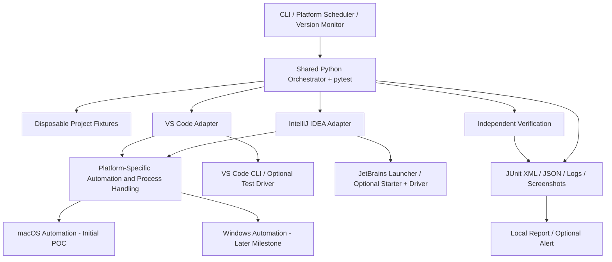
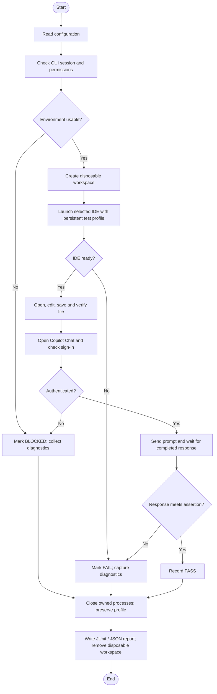
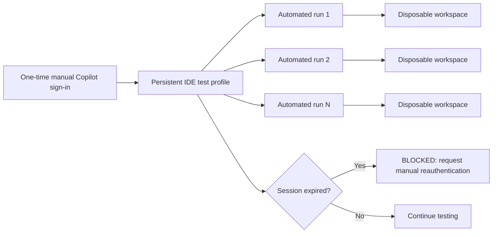
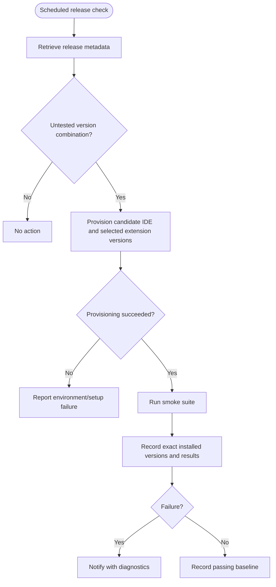

# IDE Smoke Test Harness

**Status:** Draft for analysis and refinement with an AI coding assistant  
**Target platforms:** macOS first; Windows after successful macOS proof of concept and developer approval<br>
**IDEs:** Visual Studio Code and IntelliJ IDEA  
**Initial extension/plugin:** GitHub Copilot  
**Authentication:** Reuse a previously authenticated session in dedicated persistent test profiles

**Current work scope — 2026-10-20:** The developer narrowed Copilot work to
submitting one request (`Reply with exactly the word READY.`) through the UI and
requiring `response.strip() == "READY"` for its assistant response. The
[revised M1-00 plan](../docs/implementation-plans/M1-00.md) governs this task.
Broader completion, cancellation, robustness and restart requirements below are
draft future design, outside the current work.

## 1. Purpose

Build a lightweight, largely unattended smoke-test harness for Visual Studio Code or IntelliJ IDEA and selected extensions/plugins after IDE or extension updates. Favor a small, repeatable set of observable assertions over broad end-to-end coverage. GitHub Copilot Chat is the initial extension target; the harness should accommodate other selected extensions through their own contracts, adapters, and tests.

Prove feasibility with VS Code and Copilot on macOS first. After developer approval, validate the same smoke tests on Windows before expanding to IntelliJ. Windows support requires its own feasibility validation; macOS success does not establish Windows compatibility.

### Goals

- Launch each IDE and verify readiness.
- Open a disposable project and file; edit and save; independently verify file contents.
- Verify selected extensions through extension-specific adapters and observable assertions; begin with GitHub Copilot Chat.
- Open GitHub Copilot Chat, submit a simple prompt, and verify a completed response.
- Later, request a code edit and verify it with an executable test.
- Reuse authenticated test profiles without automating passwords or MFA.
- Record host OS and version, IDE and selected extension versions, results, timings, logs, and failure screenshots.
- Eventually trigger testing on newly detected IDE or selected extension releases with minimal human intervention.

### Non-goals for the initial release

- Comprehensive IDE or extension compatibility testing.
- Testing every Copilot feature, model, or agent workflow.
- Bypassing authentication or automating MFA.
- GUI testing without a usable desktop session on either platform.
- Treating direct model API calls as proof that the IDE integration works.
- Automatically updating production IDE installations or touching personal projects.
- Local native compilation, custom native helpers, or installing Xcode, Apple’s Command Line Tools, compilers, or SDKs for the harness.

## 2. Architecture



**Separation of responsibilities:** The orchestrator defines *what* to test; adapters define *how* to interact with a specific IDE; independent verification establishes whether the intended outcome occurred.

Keep contracts, logical tests, orchestration, fixtures, and verification platform-neutral. Isolate OS-specific UI automation, process handling, and scheduling in platform implementations. Select the appropriate adapters for the configured IDE and host platform; shared code must not require macOS-only imports on Windows. Define only the platform interfaces needed by the current milestone.

### Technology choices

| Layer | Initial choice | Notes |
|---|---|---|
| Orchestration | Python 3.12+ | Shared CLI, lifecycle, fixtures, reporting |
| Test runner | pytest | Assertions, parametrization, JUnit XML |
| macOS UI | Accessibility APIs via PyObjC, subject to feasibility | Require compatible prebuilt wheels; prefer semantic UI controls over screen coordinates |
| Windows UI | Deferred to Windows feasibility milestone | Validate automation approach, selectors, and compatible prebuilt dependencies on the Windows host |
| Fallback UI actions | pyautogui, subject to platform validation | Keyboard/mouse only when necessary; fragile across UI changes |
| VS Code | CLI; optional VS Code test-driver extension | Native extension APIs do not automatically expose third-party Copilot internals |
| IntelliJ | IDE launcher; evaluate JetBrains Starter/Driver | Verify suitability and supported versions during prototype |
| Config | YAML | Profiles, test selection, timeouts, paths |
| Scheduler | macOS: per-user launchd LaunchAgent; Windows: deferred | Requires accessible GUI session; scheduling implementation belongs to Milestone 5 |
| Reporting | JUnit XML + JSON + screenshots | Capture host OS and version, exact IDE/extension versions, and failure category |

**YAGNI and dependency policy:** Install tools and dependencies only for demonstrated needs in the current milestone. Use prebuilt applications and Python, plus pure-Python packages or compatible prebuilt wheels; disable dependency builds from source during installation. Do not add compiler toolchains or custom native helpers. If a candidate dependency needs local native compilation, revisit the dependency, supported version, or automation approach. Proposed drivers, fallback libraries, and future components are candidates, not setup prerequisites; add them only when current acceptance criteria require them.

**Risk:** GitHub Copilot Chat UI automation is the critical feasibility spike. Confirm selectors, response-completion detection, and authentication reuse for each IDE/OS combination before committing to broader implementation.

## 3. Initial smoke tests

T01–T03 cover basic IDE functionality. T04–T05 cover the initial selected extension, GitHub Copilot Chat. Additional selected extensions will have their own smoke tests and acceptance criteria in later scoped work.

| ID | Test | Expected outcome | Priority |
|---|---|---|---|
| T01 | Launch IDE | Process starts and IDE becomes ready before timeout | P0 |
| T02 | Open project/file | Expected disposable file is active in editor | P0 |
| T03 | Edit and save | Disk content equals expected value | P0 |
| T04 | Open Copilot Chat | Chat interface is visible and usable | P0 |
| T05 | Copilot Chat prompt | Completed assistant response meets assertion | P0 |
| T06 | Copilot code edit | Generated change passes independent executable tests | M1 |
| T07 | Inline completion | Completion is shown and can be accepted | Later |

For T05, start with: **“Reply with exactly the word READY.”** Wait for response completion rather than assuming any UI text means success. Record the raw response; normalize minimally or relax the assertion if exact matching is unstable. Distinguish timeout, authentication failure, service error, selector failure, and unexpected response.

For T06, use a disposable Python fixture:

```python
def add(a, b):
    pass
```

Ask Copilot to implement the function, then independently run:

```python
assert add(2, 3) == 5
assert add(-1, 1) == 0
```

A passing chat test does **not** establish that inline completion or agent mode works. These are separate features and require separate tests.

## 4. Execution workflow



Run IDEs **sequentially** to avoid desktop focus collisions. Use explicit timeouts, bounded retries for known transient issues, and deterministic cleanup. Do not delete the persistent authenticated profile.

## 5. Adapter contracts

Separate IDE lifecycle, editor file operations, and extension behavior into distinct contracts. `Copilot` is the initial extension-specific contract; other selected extensions define contracts suited to their features. Compose adapters around the same IDE session rather than combining all responsibilities in one class. The following interfaces are illustrative; refine exceptions and state models during implementation. Concrete implementations are deferred to the relevant implementation milestone.

```python
from pathlib import Path
from typing import Protocol


class IDE(Protocol):
    def launch(self, workspace: Path) -> None: ...

    def wait_until_ready(self, timeout: int) -> None: ...

    def get_version(self) -> str: ...

    def close(self) -> None: ...


class EditorFiles(Protocol):
    def open_file(self, path: Path) -> None: ...

    def replace_contents(self, text: str) -> None: ...

    def save(self) -> None: ...


class Copilot(Protocol):
    def open_chat(self) -> None: ...

    def send_prompt(self, prompt: str) -> None: ...

    def wait_for_response(self, timeout: int) -> str: ...

    def get_version(self) -> str: ...
```

**Contract rules:**

- These contracts are platform-neutral; concrete implementations may vary by IDE and operating system.
- File and extension adapters receive the same IDE instance at construction time and target its session. Only the IDE adapter owns launch and process cleanup; `close()` preserves the persistent test profile and supports cleanup after a failed launch.
- The IDE must be ready before file or extension actions. Timeout values are expressed in seconds.
- `EditorFiles` performs edits through the IDE. `replace_contents()` and `save()` target the file most recently opened through `open_file()`; the adapter must ensure that file is active or raise an error. Independent disk-content verification remains outside this contract.
- `Copilot.open_chat()` makes chat usable before `send_prompt()` is called. `wait_for_response()` waits for the submitted prompt's completed response and returns its raw text; partial streaming text does not count as completion.
- Timeouts and interaction failures raise exceptions rather than returning success-shaped values. Authentication failures must remain distinguishable so the orchestrator can report **BLOCKED**.
- Each adapter reports its own installed version. The orchestrator combines IDE and extension versions for reporting.
- Additional extensions get their own contracts and adapters suited to their features. They reuse the IDE session without adding extension-specific methods to `IDE` or `EditorFiles`.

Possible later refinements: `probe_authentication()`, `capture_diagnostics()`, `capabilities()`, typed failure reasons, and explicit response-completion state.

## 6. Project structure

```text
ide-smoke-harness/
├── README.md
├── pyproject.toml
├── config/
│   ├── harness.yaml
│   ├── vscode.yaml
│   └── intellij.yaml
├── src/ide_smoke/
│   ├── cli.py
│   ├── orchestrator.py
│   ├── models.py
│   ├── version_monitor.py
│   ├── reporting.py
│   ├── adapters/
│   │   ├── base.py
│   │   ├── vscode.py
│   │   └── intellij.py
│   ├── automation/
│   │   ├── macos/
│   │   │   ├── accessibility.py
│   │   │   ├── keyboard.py
│   │   │   ├── windows.py
│   │   │   └── screenshots.py
│   │   └── windows/          # Deferred platform implementation
│   ├── authentication/
│   │   └── session.py
│   └── verification/
│       ├── filesystem.py
│       ├── copilot.py
│       └── process.py
├── tests/
│   ├── conftest.py
│   ├── test_ide_launch.py
│   ├── test_file_operations.py
│   ├── test_copilot_chat.py
│   └── test_copilot_edit.py
├── fixtures/
│   └── python-project/
│       ├── calculator.py
│       └── test_calculator.py
├── scripts/
│   ├── bootstrap_macos.sh
│   └── install_launch_agent.sh
├── scheduling/
│   └── com.example.ide-smoke.plist
└── reports/
    └── .gitkeep
```

Keep `reports/`, local profile directories, and secrets out of version control.

This is a proposed layout, not a requirement to create future modules now. Platform-specific process handling and scheduling will be organized during their implementation milestones. Tests and adapter contracts remain shared; Windows setup and scheduler files are deferred until needed.

## 7. Configuration proposal

The following YAML is a **proposed schema**, not an implemented parser. This example targets macOS. The `platform` field accepts `macos` or `windows` and must match the local host; it does not select a remote test machine. Executable and profile paths are platform-specific configuration and must be validated on the target host. Windows configuration details will be established during its milestone.

```yaml
harness:
  platform: macos
  execution_mode: sequential
  authentication:
    strategy: existing_session
    automatic_reauthentication: false
  workspace:
    disposable: true
  timeouts:
    ide_startup_seconds: 120
    copilot_response_seconds: 90
  artifacts:
    junit_xml: true
    json: true
    screenshots_on_failure: true
    logs_on_failure: true

ides:
  vscode:
    enabled: true
    executable: code
    profile_root: ~/.ide-smoke/vscode
  intellij:
    enabled: true
    application: IntelliJ IDEA
    profile_root: ~/.ide-smoke/intellij

tests:
  - launch
  - open_file
  - edit_save
  - copilot_chat

scheduling:
  enabled: false
  check_for_updates: true
  run_on_new_version: true
```

## 8. Authentication and isolation

Use **separate persistent test profiles** for each IDE on each test host, signed in manually once. Reuse those profiles on subsequent runs while creating fresh disposable workspaces. An isolated profile does **not** necessarily inherit authentication from the user's regular IDE profile. OS-managed credential storage may be involved, including macOS Keychain. Validate authentication reuse separately on Windows; do not transfer authenticated profiles or credentials between hosts.

For VS Code on macOS, evaluate a launch pattern such as:

```bash
code \
  --user-data-dir "$HOME/.ide-smoke/vscode/user-data" \
  --extensions-dir "$HOME/.ide-smoke/vscode/extensions" \
  /tmp/ide-smoke-workspace
```

For IntelliJ, evaluate isolated config, system, plugin, and log directories using supported JetBrains properties and launcher mechanisms. Validate behavior with the installed edition and plugin version.



Do not export/copy secrets or OS credential-store contents, automate MFA, or silently use personal projects. When authentication expires, classify the run as **BLOCKED** rather than an extension functional failure.

## 9. Release monitoring

Initially test **already installed** versions on demand. Later, poll authoritative IDE and selected extension/plugin release metadata and compare the detected `(IDE version, selected extension identifiers and versions, channel, platform)` combination with prior runs. Record version sources and installed versions separately; a published release is not necessarily installed or compatible. Initially the selected extension inventory contains Copilot.



Avoid updating the everyday IDE. Consider compatibility matrices, staged rollout, and safe rollback in a later design iteration. A nightly baseline run may catch remote-service failures even without a version change.

## 10. Execution constraints

### Shared requirements

- Use a dedicated logged-in test user with a usable graphical desktop on each host.
- Prevent sleep during execution and account for locked screens, session changes, and first-run prompts.
- Avoid parallel GUI runs because keyboard focus and active-window ownership are shared resources.
- Use semantic accessibility selectors where available, with tightly scoped keyboard shortcuts as fallbacks.
- Distinguish **PASS**, **FAIL**, **BLOCKED**, and **HARNESS ERROR** in reports.
- Store failure artifacts without leaking tokens, private conversations, or unrelated desktop content.

### macOS

- Grant required Accessibility, Automation, and (if screenshots are needed) Screen Recording permissions during setup.
- Prefer a per-user `launchd` LaunchAgent; do not assume a system LaunchDaemon can drive the GUI.

### Windows — validation deferred to Milestone 2

- Validate UI automation, required permissions, window targeting, owned-process cleanup, and behavior under session locking or disconnection on the Windows test host.
- Select the Windows scheduler during its feasibility work; implement and validate scheduled execution in an accessible desktop session in Milestone 5.

## 11. Delivery milestones and validation gates

Milestones define delivery outcomes. Implementation phases within each milestone will be defined during implementation.

### Milestone 0 — macOS environment setup

Prepare prebuilt Python with uv and install only the supporting software needed now, without compiler tooling or native source builds, as described in the [Milestone 0 setup guide](ide-milestone0-environment-setup.md). IDE configuration, authentication, permissions, and feasibility validation belong to Milestone 1.

```mermaid
flowchart LR
    M1[Milestone 1<br/>macOS VS Code + Copilot POC] --> G1{Developer validates}
    G1 -- Pass --> M2[Milestone 2<br/>Windows setup + VS Code feasibility + support]
    G1 -- Revise --> M1
    M2 --> G2{Developer validates}
    G2 -- Pass --> M3[Milestone 3<br/>IntelliJ support]
    G2 -- Revise --> M2
    M3 --> G3{Developer validates}
    G3 -- Pass --> M4[Milestone 4<br/>Reliability + diagnostics]
    G3 -- Revise --> M3
    M4 --> G4{Developer validates}
    G4 -- Revise --> M4
    G4 -- Pass --> M5[Milestone 5<br/>Version watch + platform scheduling]
    M5 --> G5{Developer validates}
    G5 -- Revise --> M5
    G5 -- Pass --> D([Initial rollout])
```



### Milestone 1 — macOS VS Code proof of concept

- Implement CLI, fixtures, VS Code IDE/file/Copilot adapters, and T01–T05 on macOS.
- Keep shared contracts and logic platform-neutral; defer Windows dependencies and implementation.
- Prove Copilot Chat can be opened, prompted, and observed to completion.
- Establish persistent test-profile authentication.
- **Exit gate:** Multiple repeatable unattended runs against unchanged versions, with no interaction after initial setup. Decide a measurable reliability threshold before accepting the milestone.

### Milestone 2 — Windows environment setup, VS Code feasibility, and support

- Begin only after developer approval of the macOS proof of concept.
- Prepare the Windows test environment: install prebuilt Python with uv, VS Code, Copilot, and only the dependencies needed for this milestone; configure a dedicated test user/session, persistent test profile, required permissions, and disposable workspace paths. Retain the prebuilt-dependency policy; do not install compiler tooling or build dependencies from source.
- Inspect the Windows host and validate launch, isolated profiles, UI automation, file editing/saving, Copilot Chat accessibility, response-completion detection, and authentication reuse.
- Select Windows automation dependencies and the future scheduling approach based on this evidence, retaining the prebuilt-dependency policy.
- Implement Windows automation and adapters as needed, reusing the contracts and logical T01–T05 tests. Establish manual initial authentication in a dedicated Windows profile.
- **Exit gate:** T01–T05 pass repeatedly and unattended after setup on Windows, and the macOS suite still passes. Agree a measurable reliability threshold before accepting this milestone; report platform-specific limitations and evidence for developer validation.

### Milestone 3 — IntelliJ IDEA support

- Implement equivalent IDE/file/Copilot adapters using the shared contracts and tests on macOS and Windows.
- Confirm GUI automation and persistent sign-in on the installed IntelliJ edition on each platform.
- **Exit gate:** Shared logical suite passes in both IDEs on both platforms.

### Milestone 4 — Reliability and diagnostics

- Add bounded timeouts/retries, typed failure classifications, cleanup, version inventory, JUnit XML/JSON, and screenshots.
- **Exit gate:** Deliberately injected failures on both platforms produce actionable diagnostic reports without hanging or damaging profiles.

### Milestone 5 — Release monitoring and scheduling

- Add release metadata checks, platform-aware version-combination tracking, candidate provisioning, and platform-specific scheduling (`launchd` on macOS; the validated Windows scheduler on Windows).
- **Exit gate:** On each platform, an untested candidate release triggers a run; a previously tested combination is skipped unless explicitly forced.

## 12. Proposed CLI

These commands are **design targets**, not implemented commands:

Commands run on the local host using configuration for that platform. Remote Windows execution from macOS is outside this proposal's scope.

```bash
ide-smoke run --ide vscode
ide-smoke run --ide intellij
ide-smoke run --ide all
ide-smoke check-updates
ide-smoke report --latest
```

## 13. Risks and mitigations

| Risk | Impact | Mitigation |
|---|---|---|
| Copilot UI changes | Fragile selectors | Centralize locators per adapter; capture UI diagnostics |
| Copilot response nondeterminism | False failures | Assert completion and simple properties; log raw result |
| Authentication expires | Unattended run blocked | Preserve profiles; detect and report BLOCKED |
| GUI session unavailable | Test cannot run | Preflight session/permission checks |
| Platform-specific UI or authentication behavior | macOS success does not predict Windows results | Validate each IDE/OS combination using the shared logical tests |
| Service outage or throttling | Failure unrelated to IDE update | Separate service/network failures from IDE regression |
| IDE update changes first-run dialogs | Automation stalls | Explicit readiness checks, timeouts, screenshots |
| Existing IDE instances interfere | Wrong window/profile | Launch and track owned instances; isolate test user |
| Test modifies personal files | Data loss | Disposable workspaces; strict path safety checks |
| Release metadata differs from installed version | Misleading report | Inspect and record actual installed versions |

## 14. Open questions for refinement

1. Which VS Code channel and IntelliJ edition/channel should be tested (Stable, Insiders, Community, Ultimate, etc.)?
2. Is GitHub Copilot Chat the initial required feature, or must inline completion and agent mode also be in scope?
3. Can tests use a dedicated login session on each platform, or must they coexist with normal desktop use?
4. How will the harness detect that a Copilot response has *finished*, not merely started streaming, in each IDE?
5. What exact UI selectors or native APIs are reliable in the installed versions?
6. How should first-run dialogs, trust prompts, workspace indexing, and extension activation be handled?
7. What repetition count and acceptable false-failure rate constitute a reliable POC?
8. Which authoritative sources and compatibility rules should govern release monitoring?
9. Should reports remain local or integrate with GitHub Actions, email, or another notification channel?
10. What is the desired behavior when a new release fails: alert only, retry, or preserve the previous tested baseline?
11. Which Windows versions, IDE channels, and local or virtual test-host environments should be supported?

## 15. Instructions for an AI coding assistant

Use this document as the **initial design proposal**, not a fully validated implementation specification.

1. **First perform a feasibility spike:** inspect the local macOS environment and installed IDEs; verify CLI launch, isolated profiles, Copilot Chat accessibility, response-completion detection, and session reuse. Do not assume proposed APIs or selectors work.
2. **Identify unknowns explicitly:** distinguish verified behavior, assumptions, and decisions requiring developer input.
3. **Create a milestone-based implementation plan:** define tasks, dependencies, acceptance criteria, and rollback/cleanup steps for each milestone.
4. **Implement Milestone 1 only at first:** use small, reviewable changes and unit tests for non-GUI logic. Keep shared contracts, tests, and logic platform-neutral while isolating macOS automation and imports. Do not proceed to Windows, IntelliJ, or release monitoring until the relevant developer checkpoint is approved.
5. **Use closed-loop execution within each milestone:** implement, run tests, inspect artifacts, fix issues, and repeat within a bounded retry budget.
6. **Require a developer checkpoint between milestones:** summarize outcomes, limitations, evidence, and outstanding risks; wait for approval.
7. **Apply YAGNI:** prioritize a reliable macOS VS Code + Copilot Chat smoke test; add tools, dependencies, and abstractions only for demonstrated current-milestone needs. Defer Windows dependencies and implementation until Milestone 2. Use prebuilt dependencies and disable source builds; reconsider any approach that requires local native compilation instead of installing compiler tooling.
8. **Never manipulate live user projects or credentials:** use dedicated profiles, disposable fixtures, and safe cleanup.

### Suggested first coding-assistant prompt

> Review `ide-copilot-smoke-harness-proposal.md` as a draft proposal. Critique feasibility and technical assumptions, especially macOS Accessibility automation of GitHub Copilot Chat, session reuse, and response-completion detection. Separate verified facts from assumptions. Propose a Milestone 1 implementation plan for VS Code on macOS only, with concrete tasks, acceptance criteria, diagnostic artifacts, and a developer validation gate. Keep shared contracts and logic platform-neutral; defer Windows implementation to Milestone 2 and IntelliJ to Milestone 3. Do not implement code until I approve the plan.
